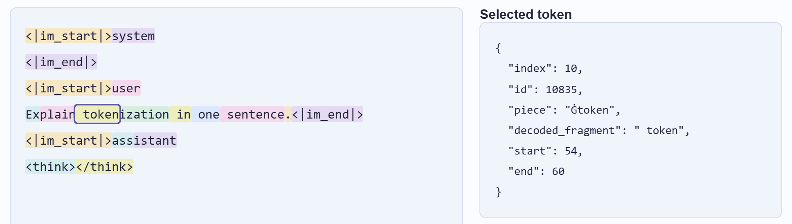

# Exercise: a token viewer for chat requests

Build a token viewer for chat requests. Given a model on Hugging Face and a list of chat messages, it shows the exact tokens the model reads: the text the chat template writes, every token's ID, vocabulary entry and position, and the details of a selected token. With a captured provider response, it also shows the returned answer re-tokenized and the response's metadata. You decide which files to download and which libraries to use.



_What a token viewer shows: the tokens the model reads for the course request, after the chat template, and the details of one selected token. The starter's page shows the same things in a layout of its own._

Each group builds the viewer in its own repository, created from a starter template, and works on it in class. The repository stays the group's for the semester and grows into an evaluation framework: design it so that new data sources, commands and views can be added.

You write Python. The starter's page is written in TypeScript and already runs. It shows whatever your Python code sends it, so changing the TypeScript is optional; see [Python is enough](#python-is-enough).

## Get started

The starter is a public template repository: [L3GJ0N/eaas_token_viewer_starter](https://github.com/L3GJ0N/eaas_token_viewer_starter). It runs end to end from the first day: a fake controller answers every command with made-up data. Its licence, MIT-0, lets you use and change its code without conditions.

Every member needs a GitHub account and four tools, which [section 1 of the starter's README](https://github.com/L3GJ0N/eaas_token_viewer_starter/blob/main/README.md#1-run-everything) lists with their installers: Git, uv, Node.js 24 LTS or newer, and VS Code 1.112 or newer. Install and check them before the session: `git --version`, `uv --version`, `node --version`, and **Help > About** in VS Code (on macOS, **Code > About Visual Studio Code**). Stuck with the setup? The starter's [SETUP_PROMPT.md](https://github.com/L3GJ0N/eaas_token_viewer_starter/blob/main/SETUP_PROMPT.md) is a prompt for a coding agent that walks you through it without changing any code.

1. **Create your group's repository.** One member opens the starter's page, clicks **Use this template**, then **Create a new repository**, chooses their account as **Owner**, a name, and **Private** or **Public**, and clicks **Create repository from template**. That member then adds the others: in the new repository's **Settings**, **Collaborators** in the **Access** section, then **Add people**. Each of them accepts the invitation GitHub sends by e-mail. The starter's [GUIDE.md](https://github.com/L3GJ0N/eaas_token_viewer_starter/blob/main/GUIDE.md#your-groups-repository) has the details.
2. **Clone it.** In VS Code, select **View > Command Palette**, run **Git: Clone**, choose **Clone from GitHub**, sign in when VS Code asks, and pick your group's repository. In a terminal, `git clone` with the address under **Code** on the repository's page works too; for a private repository, GitHub does not accept your account password there. Git for Windows opens a sign-in window; on macOS, Linux and in WSL, clone through VS Code as above, or run `git clone` in VS Code's own terminal, where VS Code handles the sign-in.

   On Windows, clone into a short folder outside OneDrive, such as `C:\Users\<name>\repos`: a deep path breaks some tools. In WSL, first connect VS Code to WSL: install the WSL extension, click the remote indicator at the bottom left and choose **Connect to WSL**. In that window, install uv and Node.js as on Linux, and do steps 2 to 6 there: the clone then lands in the WSL file system.

   Before your first commit, tell Git who you are: `git config --global user.name "Your Name"`, and `git config --global user.email` with your address. In a public repository, that address is public with every commit; GitHub's **Settings > Emails** offers a noreply address instead.
3. **Open the workspace, not the folder.** Select **File > Open Workspace from File** and choose `token_viewer.code-workspace` in the clone. Only the workspace gives VS Code the settings and debug configurations of both parts, and keeps editor AI suggestions off. When VS Code asks whether you trust the authors, choose **Yes, I trust the authors**: in Restricted Mode, debugging and tasks are switched off. Install the extensions it recommends: Python, Python Debugger and Ruff.
4. **Start the back end.** Select **Terminal > New Terminal**. VS Code asks for a folder: choose **repository**. Then run:

   ```console
   cd backend
   uv sync
   uv run uvicorn token_viewer.api:app --port 8000
   ```

5. **Start the page.** Leave the back end running. Open a second terminal, again in **repository**, and run:

   ```console
   cd frontend
   npm ci
   npm run dev
   ```

   Open <http://localhost:5173>. The page shows the fake controller's made-up tokens; the starter's [GUIDE.md](https://github.com/L3GJ0N/eaas_token_viewer_starter/blob/main/GUIDE.md#try-the-starter) says what to try first. On Windows, if PowerShell refuses `npm` because running scripts is disabled, type `npm.cmd` instead, or see the starter README's troubleshooting table.
6. **Debug both processes.** The debugger starts a back end of its own, so first stop the one from step 4: close its terminal with **Kill Terminal**, or press Ctrl+C in it (Control, also on macOS). Keep `npm run dev` running: no debug configuration starts it. Then select the **Run and Debug** view, choose **Full stack: back end + browser** and click **Start Debugging**.

The starter's [README](https://github.com/L3GJ0N/eaas_token_viewer_starter/blob/main/README.md) has the details, the checks and a troubleshooting table. Its [GUIDE.md](https://github.com/L3GJ0N/eaas_token_viewer_starter/blob/main/GUIDE.md) says what the starter provides, what is yours, what to try first, and where the first breakpoints go.

## What the course repository gives you

- **A first look.** Update your copy of the course repository first, with `git pull` or a new download: `token_lab` came after the first lecture. [token_lab](../../token_lab/README.md) shows the first steps for the course model, Nemotron 3.5 Lightning. In `token_lab`, after `uv sync`, `uv run tokenize-text` shows the tokens of a text alone, and `uv run tokenize-chat` the tokens the model reads after the chat template.
- **The course request.** It is the request the NVIDIA examples in [llm_inference](../../llm_inference/README.md) send: one user message, "Explain tokenization in one sentence.", to `nvidia/nemotron-3.5-lightning-30b-a3b` on NVIDIA Build. [samples/course_messages.json](samples/course_messages.json) holds its messages as JSON.
- **How this repository works.** `llm_inference` and `token_lab` are the examples: uv, a `src` layout, strict typing, Ruff, offline tests and pinned revisions. The starter's Python side already uses uv, Ruff, mypy and pytest. You are encouraged to work the same way.

## What to deliver, in this order

Each step ends with something that runs, so your group can stop at any point and present what works.

### 1. The 24 tokens in the terminal view

- Load a model's tokenizer and chat template from its repository on Hugging Face, at a pinned revision. After the first download, everything works offline.
- Turn the messages into the text the chat template writes, and that text into tokens. Tokenize the text alone, without the chat template, as well.
- A terminal view on your own controller and model shows every token with its index, ID, vocabulary entry and decoded text, marks the special tokens, and gives the count.
- For the course request, Nemotron 3.5 Lightning gives the known 24 tokens: the same IDs, in the same order, as `uv run tokenize-chat` prints in `token_lab`.

### 2. The page

- The starter's page shows the same tokens through your controller, with the details of a selected token.
- The terminal view and the page are two views on the same model and controller classes. Each runs in its own process, with its own instance.
- The proof of your design: the page, written by someone else, works with your controller after a change to `wiring.py` only, without any change to your model or your controller.

### 3. The emoji case and the offsets

- Every token has its offsets: where it begins and ends in the text of its view.
- Characters split across tokens are handled visibly: the emoji case, for example 👋🏽.

### 4. Captures

- Load a capture as `capture-nvidia-response` in `llm_inference` writes it. The page's **Load capture** button sends a chosen capture file to your controller.
- Show the answer and the reasoning re-tokenized, labelled as re-tokenization.
- Show the response metadata: the requested and the reported model, the provider, the HTTP status, the finish reason, the usage, the elapsed time, and the prompt tokens, local versus reported.

A sample capture will follow in `samples/`. With an NVIDIA key you can make your own: configure the key as the [llm_inference README](../../llm_inference/README.md) describes, then run `uv run capture-nvidia-response` in `llm_inference`. It saves the capture, without credentials, in `llm_inference/outputs/`. Each run is one more live request.

### 5. Optional

- A second model of your choice, with different files.
- Further extras: a table of the returned log probabilities, when a capture has them; vocabulary search; two models side by side; a JSON export view.

## Python is enough

Every step can be done in Python. After each command, your controller returns a view-model, plain data defined in `backend/src/token_viewer/view_models.py`, and the starter's page shows whatever it carries:

- The chips show `TokenView.text`, as your Python code sets it.
- The detail panel shows every field of the selected token.
- Further fields of the view-model and of the capture appear as JSON.
- Further token sequences, such as the re-tokenized answer, appear as views in the view selector.

Changing the TypeScript is optional. Node.js is still needed to run the page, with `npm ci` and `npm run dev`.

## Coding agents: for hints only

- Asking a coding agent or a chatbot for explanations, pointers to documentation or a hint is allowed. Letting it write the solution is not.
- Every prompt goes into `AI_USAGE.md` in your repository, when you send it. The starter's `AI_USAGE.md` has the table.
- Editor AI suggestions write code without a prompt, so they stay off. The starter's workspace switches off VS Code's inline suggestions and Copilot's next edit suggestions: keep them off, and switch them off in any other editor you use.
- Never put a key, an access token or a password into a prompt, the log or the repository.

## The presentation

At the end of the exercise, each group presents what it achieved, in class, in 10 minutes. Show your own repository live, in the editor, the terminal and the page, not on slides. Every member speaks. In this order:

1. **Run it from the README:** start the back end, the page and, once it exists, the terminal view, live, with the steps your README names.
2. **Show what works**, in the order of the steps above, as far as your group got.
3. **Follow one click through the processes, with breakpoints:** from the page in the browser to the Vite development server, a Node.js process, through its proxy to the FastAPI application, a Python process run by uvicorn, and into the route, the controller and the model. Show **Variables** at each stop. Until your controller is plugged in at `wiring.py`, the click reaches the starter's fake controller.
4. **Show the AI-use log:** `AI_USAGE.md` lists every prompt. Show two or three and what you took from them.

## Samples

`samples/` holds [course_messages.json](samples/course_messages.json), the course request's messages. A sample capture follows later.
