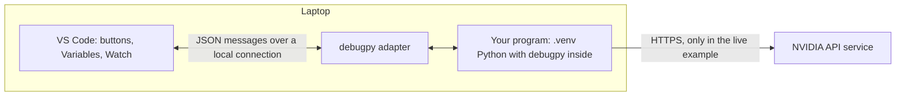

# Debugging the examples in VS Code

A debugger lets you pause a running Python program, look at its variables and run it line by line. This guide uses the offline example first, then the live NVIDIA request. Labels follow VS Code's English interface. Each step names the menu or button first; keyboard shortcuts are optional and listed per platform in [section 5](#5-move-through-the-code).

The debugger controls only the Python process on your laptop. In the live example it can follow the request until `requests.post(...)` sends it, and the response after it returns. It cannot step through the model, which runs at NVIDIA.

## 1. What a debugger does

**A Python debugger is ordinary Python code running inside your program's process.** Python can notify a registered tool before each line runs and when a function is called or returns: [`sys.settrace`](https://docs.python.org/3/library/sys.html#sys.settrace), and since Python 3.12 the faster [`sys.monitoring`](https://docs.python.org/3/library/sys.monitoring.html). The debugger used by VS Code, `debugpy`, compares each notification with your breakpoints and step commands. To pause, it keeps your program's thread waiting inside debugger code. While paused, it reads the current function's variables for display and evaluates the expressions you type inside the program.

VS Code itself does not run your Python code. It exchanges JSON messages with `debugpy` over a local connection, following the [Debug Adapter Protocol](https://microsoft.github.io/debug-adapter-protocol/): "set a breakpoint at this line", "step over", "which local variables exist?". This is the idea from the HTTP lesson, two programs exchanging structured JSON, but everything stays on the laptop.



Python's standard library also contains a small terminal debugger built on the same mechanism, [pdb](https://docs.python.org/3/library/pdb.html). From the project root:

```console
uv run python -m pdb -m eaas_llm_inference.inspect_http_request
```

pdb pauses on the module's first line and waits for commands:

| pdb command | Meaning | VS Code equivalent |
|---|---|---|
| `b main` | Set a breakpoint at the start of `main()`. | Click the editor gutter. |
| `c` | Continue to the next breakpoint. | **Continue** |
| `n` | Run the current line and stop at the next one. | **Step Over** |
| `p url` | Print the value of an expression. | **Watch** or **Debug Console** |
| `q` | Quit. | **Stop** |

When the program has finished, pdb restarts it and pauses on line 1 again; type `q` to quit. VS Code offers the same operations with buttons and panels.

## 2. Prepare once

Install Microsoft's **Python** (`ms-python.python`) and **Python Debugger** (`ms-python.debugpy`) extensions; the workspace recommends them together with the Ruff extension. No Copilot subscription is required.

Use **File > Open Folder** and select either the outer **repository folder** (`engineering_agentic_ai_systems_hs_aalen`, or `engineering_agentic_ai_systems_hs_aalen-main` from a ZIP download) or **`llm_inference` itself**. Both folders contain launch configurations with the same **LLM:** names: the repository-root [launch.json](../.vscode/launch.json) points into this project, while the project-local [launch.json](.vscode/launch.json) uses local paths. VS Code reads the opened folder's configuration; it does not discover every nested `.vscode` folder.

Open **Terminal > New Terminal**. The commands in this guide run in `llm_inference`; if the terminal starts at the repository root, first run `cd llm_inference`. Then prepare the environment:

```console
uv sync
```

The same `uv sync` and `uv run ...` commands work in Windows PowerShell, macOS shells such as zsh, and Ubuntu/Linux shells such as bash. No manual environment activation is needed. Each student creates `.venv` locally with uv; do not copy it between operating systems.

The supplied launch configurations name the interpreter directly, so **Python: Select Interpreter** is not needed for them:

| Where Python runs | Interpreter selected by the supplied launch configurations |
|---|---|
| Windows | `.venv/Scripts/python.exe` |
| Ubuntu / other Linux distributions | `.venv/bin/python` |
| macOS, including Intel and Apple silicon | `.venv/bin/python` |

The `"windows"` override in `launch.json` selects the first path; macOS and Linux use the default path. These paths are relative to the project folder. Selecting the interpreter still matters for editor features and for debugging the currently open file ([section 8](#8-other-ways-to-start-current-file-and-attach)).

If using **WSL**, open the folder in a VS Code WSL window and run uv inside that Linux environment. Install the Python extensions in WSL when prompted and use a Linux `.venv` there. A separate checkout inside WSL avoids mixing Windows and Linux environments. [VS Code with WSL](https://code.visualstudio.com/docs/remote/wsl).

Opening from a terminal is optional: `code -n .` opens the current folder in a new VS Code window when `code` is on PATH. On macOS, use **View > Command Palette**, run **Shell Command: Install 'code' command in PATH**, and restart the terminal if you want this shortcut. [VS Code on macOS](https://code.visualstudio.com/docs/setup/mac).

## 3. Start the offline example

The offline example uses a fake credential and sends nothing, so it is safe to project in class.

1. Open [inspect_http_request.py](src/eaas_llm_inference/inspect_http_request.py). Click the editor gutter left of the line `prepared: requests.PreparedRequest = requests.Request(`. A red dot marks the breakpoint.
2. Select the **Run and Debug** icon in the Activity Bar: the play triangle with a small bug. Choose **LLM: Inspect HTTP (offline)** in the dropdown at the top and click the green **Start Debugging** triangle beside it. **Run > Start Debugging** does the same.
3. Watch the start:
   - **The pre-launch task runs `uv sync`.** It appears in the terminal panel's list as `uv: sync` (project folder open) or `uv: sync llm_inference` (repository root open). A check mark means uv succeeded; only then does VS Code start Python. If uv fails, VS Code asks whether to debug anyway: choose **Abort** and read the task's output.
   - **A terminal named Python Debug Console shows the launch command.** On Windows it looks similar to:

     ```text
     & '...\llm_inference\.venv\Scripts\python.exe' '...\ms-python.debugpy-...\bundled\libs\debugpy\launcher' '56750' '--' '-m' 'eaas_llm_inference.inspect_http_request'
     ```

     The interpreter comes from `.venv`, the debugger code from the VS Code extension, the number is a local port for the debugger's own connection, and everything after `--` is what `python -m` would run. `&` is PowerShell's call operator; on macOS and Linux the command looks slightly different. Because the extension supplies `debugpy`, the project does not list it as a dependency.
   - **On Windows, a reused debug terminal may first show** `(Set-ExecutionPolicy -Scope Process -ExecutionPolicy RemoteSigned) ; (& ...\.venv\Scripts\Activate.ps1)`. The Python extension activates `.venv` in that terminal and relaxes PowerShell's script policy for that terminal process only. It is harmless, and the debugger does not need it: the launch command already names the interpreter.
4. **The debugger pauses on line 1.** `"stopOnEntry": true` stops before the module's first line runs; for our module that is the docstring. Nothing has been imported yet. Click **Continue** in the debug toolbar to run to your breakpoint; hovering over a toolbar button shows its name.

## 4. Look around while paused

**The highlighted line has not run yet.** At the breakpoint, `url`, `headers` and `body` exist, but `prepared` does not.

- **Variables** shows **Locals**, the names inside the current function, and **Globals**, the names of the module. The groups `special variables` and `function variables` collect Python's internal attributes and methods. Under the debugger, Globals also contains `cli`, `debugpy` and `sys`: debugpy's starter runs your module in its own namespace and leaves these names behind. They do not exist under `uv run`.
- **Call Stack** lists the active function calls, innermost first: `main` above `<module>`, where the `main()` call in the `__name__` guard started it. Click a frame to show that frame's variables.
- **Watch** shows expressions you choose. Hover over the **Watch** header and click **+** (**Add Expression**). Expressions are evaluated again at every pause; before an assignment has run, they show a `NameError`.
- **Debug Console** is a tab in the bottom panel, also under **View > Debug Console**. Type an expression and press Enter; it is evaluated in the frame selected in **Call Stack**, and output of `print(...)` appears there.
- Hovering over a name in the editor shows its value.

Watch and Debug Console expressions are real Python executed inside your paused program. Avoid expressions with side effects; in the live example, typing `requests.post(...)` there would really send a request.

Click **Step Over** once, so that `prepared` exists, and try:

| Expression | Expected result | What it shows |
|---|---|---|
| `prepared.headers` | `Authorization`, `Content-Length: 257`, `Content-Type` | `.prepare()` added two headers. |
| `type(prepared.body)` | `<class 'bytes'>` | The JSON body has been encoded as bytes. |
| `len(prepared.body)` | `257` | `Content-Length` counts body bytes, not tokens. |
| `prepared.headers["content-length"]` | `'257'` | Header names ignore case; values are text. |
| `requests.utils.default_headers()` | `User-Agent`, `Accept-Encoding`, `Accept`, `Connection` | Headers that `requests.post(...)` adds, but this preview does not. |

## 5. Move through the code

| Debug toolbar button | What it does |
|---|---|
| **Continue** | Run until the next breakpoint or the end of the program. |
| **Step Over** | Run the highlighted line completely, including every function it calls, and pause on the next line. |
| **Step Into** | Pause on the first line inside the next function that the highlighted line calls. With the supplied settings, only our own code counts ([section 6](#6-step-into-requests-justmycode)). |
| **Step Out** | Finish the current function and pause in its caller. The caller can still be on the same line: one line can contain several calls. |
| **Restart** | End the session and start it again. |
| **Stop** | End a launched program. |

Default shortcuts are optional conveniences:

| Action | Menu or mouse route | Windows | Ubuntu / Linux | macOS |
|---|---|---|---|---|
| Open Run and Debug | Select its Activity Bar icon. | Ctrl+Shift+D | Ctrl+Shift+D | Cmd+Shift+D |
| Open Command Palette | View > Command Palette | Ctrl+Shift+P | Ctrl+Shift+P | Cmd+Shift+P |
| Open Debug Console | View > Debug Console | Ctrl+Shift+Y | Ctrl+Shift+Y | Cmd+Shift+Y |
| Toggle a breakpoint | Click the editor gutter beside the line. | F9 | F9 | F9 |
| Start debugging | Run > Start Debugging | F5 | F5 | F5 |
| Continue to the next stop | Continue button in the debug toolbar | F5 | F5 | F5 |
| Step over a statement | Step Over button in the debug toolbar | F10 | F10 | F10 |
| Step into a function | Step Into button in the debug toolbar | F11 | F11 | F11 |
| Step out of a function | Step Out button in the debug toolbar | Shift+F11 | Shift+F11 | Shift+F11 |
| Stop a launched session | Stop button in the debug toolbar | Shift+F5 | Shift+F5 | Shift+F5 |

Here **Cmd** means the macOS Command key (`⌘`). Depending on the keyboard and OS settings, function keys may require **Fn** or may be intercepted by system actions. Keymap extensions and personal shortcuts can also change the defaults. Use the menu or button whenever a shortcut does something else. To inspect the actual binding, open **View > Command Palette**, choose **Preferences: Open Keyboard Shortcuts**, and search for the action. [VS Code debugging](https://code.visualstudio.com/docs/debugtest/debugging), [keyboard shortcuts](https://code.visualstudio.com/docs/configure/keybindings).

If the Run and Debug icon is hidden, **View > Command Palette > Debug: Select and Start Debugging** lets you choose a configuration directly. [Selecting a debug configuration](https://code.visualstudio.com/docs/debugtest/debugging-configuration).

## 6. Step into Requests: justMyCode

The supplied configurations set `"justMyCode": true`. Your program runs the same either way; the setting changes what the debugger lets you see and stop in:

| | `true` (supplied) | `false` |
|---|---|---|
| Call Stack | Only our frames | Library frames too, collapsed behind **Show N More Stack Frames** |
| **Step Into** on the preparation line | Behaves like **Step Over** | Opens Requests' `models.py` |
| Breakpoints in library files | Ignored | Hit |

To try it, change `"justMyCode"` to `false` in **LLM: Inspect HTTP (offline)** in the `launch.json` of the folder you opened: `.vscode/launch.json` at the repository root, or `llm_inference/.vscode/launch.json`. Save and start a new session; the file is read when a session starts. **Step Into** on the preparation line now opens `models.py` in `.venv`'s `site-packages` folder: first the `Request` constructor, and after **Step Out** and another **Step Into**, the `prepare()` method that builds the headers and body. Everything you step through still runs locally.

Revert the change afterwards: set `"justMyCode"` back to `true` and save. In a Git clone, the **Source Control** view does the same: right-click `launch.json` and choose **Discard Changes**. [Python debugging in VS Code](https://code.visualstudio.com/docs/python/debugging).

## 7. Debug the live request safely

**A paused live session shows your API key.** As soon as the debugger pauses after the key has been read, **Variables > Locals** displays `api_key` and the `config` dictionary in plain text, without expanding anything. Hovering over `api_key` and expanding `response.request.headers` show it too. Therefore:

- Collapse **Variables** before sharing your screen or taking a screenshot, and work with **Watch** and the **Debug Console**.
- Use the offline configuration for projected demonstrations; inspect live responses privately.
- If a key has been exposed, revoke it in NVIDIA Build and generate a new one.

Then, with your private `.env` configured as described in the [project README](README.md#run-the-project):

1. Open [nvidia_inference.py](src/eaas_llm_inference/nvidia_inference.py). Set breakpoints on the line `response: requests.Response = requests.post(` and on the final `print(result[...])`.
2. Select **LLM: NVIDIA inference (live)**, click **Start Debugging**, and click **Continue** past the pause on line 1.
3. At the first breakpoint, nothing has been sent yet. **Step Over** sends the request and waits for the complete response; your Python process is blocked inside `requests.post(...)` meanwhile.
4. Inspect the response in **Watch** or the **Debug Console**: `response.status_code`, `response.headers`, `response.elapsed`. `response.content` holds the body as raw bytes; expanding it shows methods of the `bytes` type, not JSON fields.
5. Click **Continue** to the final print. Now `result` holds the parsed body: add `result` to **Watch** and expand `choices`, `0` and `message`, then `usage`. For readable JSON, enter `import json` and then `print(json.dumps(result, indent=2, ensure_ascii=False))` in the **Debug Console**.

If NVIDIA returns an error status, the debugger normally stops at `raise_for_status()` because **Uncaught Exceptions** is enabled in the **Breakpoints** view; inspect `response.status_code` and `response.text` there.

**LLM: NVIDIA inference via OpenAI SDK (live)** debugs the [SDK version](nvidia_walkthrough.md#14-compare-the-same-request-with-the-openai-sdk) the same way. There, the key is also stored in the client object: expanding `client` in **Variables** shows `client.api_key`. Set a breakpoint on the final `print(...)` and inspect `completion`, the parsed answer as typed objects. An error status stops the debugger at the `client.chat.completions.create(` call with an exception such as `openai.RateLimitError`, whose message includes NVIDIA's explanation.

[What comes back?](http_and_requests.md#7-what-comes-back) explains every part of the response object, and the [response inspection](nvidia_walkthrough.md#10-inspect-one-response) explains each body field. To keep a key-free record of one exchange without the debugger, run `uv run capture-nvidia-response` ([project README](README.md#run-the-project)).

## 8. Other ways to start: current file and attach

| Option | How execution starts | When to use it |
|---|---|---|
| Start Debugging with the supplied launch configurations | A `uv sync` task prepares `.venv`; VS Code launches that environment's Python with a module. | Recommended for the course exercises. |
| Debug the currently open Python file | After `uv sync`, select `.venv` with **Python: Select Interpreter** and choose **Python Debugger: Debug Python File**. | Quick exploration; the selected interpreter and active file matter. |
| Start with `uv run`, then attach | `uv run --with debugpy` starts Python and waits; VS Code connects to it. | Learn the difference between launching and attaching, or keep a terminal-driven workflow. |

To attach, first set a breakpoint in the offline example. Use the terminal inside the same VS Code environment as the debugger (for WSL, its WSL terminal). From the project root, run:

```console
uv run --with debugpy python -m debugpy --listen 127.0.0.1:5678 --wait-for-client -m eaas_llm_inference.inspect_http_request
```

The terminal appears to wait: that is expected. In **Run and Debug**, select **LLM: Attach to uv/debugpy (5678)** and click **Start Debugging**. The process now continues to your breakpoint. An attached session does not pause on line 1. Finish this session before starting another on the same port. For the live request, use the same command with `-m eaas_llm_inference.nvidia_inference`.

`--with debugpy` makes the debugger available for this invocation without editing `pyproject.toml` or `uv.lock`; its first use may download the package. `python -m debugpy` starts the debugger, while the second `-m` selects our module. `--listen` opens a debugger endpoint on this machine's loopback address, and `--wait-for-client` waits until VS Code attaches before running the module. This debug port is separate from the HTTPS connection to NVIDIA. [uv additional dependencies](https://docs.astral.sh/uv/concepts/projects/run/#requesting-additional-dependencies), [debugpy command-line usage](https://github.com/microsoft/debugpy#command-line-usage).

For a persistent development dependency instead, run `uv add --dev debugpy` once and omit `--with debugpy` afterwards; the lockfile then records the debugger version. The project currently uses the temporary `--with` variant.

If an attached process remains active after disconnecting, focus its terminal and press **Ctrl+C** (Control, also on macOS), or close that terminal with its trash-can button. Restart the terminal command for the next attach session.

## 9. What the launch configuration says

The repository-root [configuration](../.vscode/launch.json) provides the same launches as the project-local one, with paths prefixed by `llm_inference/` and the task name `uv: sync llm_inference`:

| File or setting | Role |
|---|---|
| [launch.json](.vscode/launch.json) | Defines the offline launch, the two live launches (Requests and OpenAI SDK), plus the attach configuration. |
| `"type": "debugpy"` | Uses Microsoft's Python debugger. |
| `"request": "launch"` | Starts a new Python process under the debugger; `"attach"` connects to a running one. |
| `"module": "eaas_llm_inference.nvidia_inference"` | Equivalent module target to `python -m ...`; the module's `__main__` guard calls `main()`. |
| `"python"` and its `"windows"` override | Explicitly select `.venv`'s interpreter on each platform. uv itself is not a Python interpreter. |
| `"preLaunchTask": "uv: sync"` | Runs the task declared in [tasks.json](.vscode/tasks.json) before starting Python. That task executes ordinary `uv sync` in the project root. |
| `"cwd": "${workspaceFolder}"` | Makes the project folder the working directory. |
| `"console": "integratedTerminal"` | Runs the program in the **Python Debug Console** terminal, where its printed output appears. |
| `"envFile": ""` | Disables the extension's automatic `.env` loading. Our Python code still reads its private configuration explicitly with `dotenv_values`. |
| `"stopOnEntry": true` | Pauses before the module's first line, even without a breakpoint. |
| `"justMyCode": true` | Limits stepping and the call stack to our own code. |
| [settings.json](.vscode/settings.json) | Suggests the uv environment to the Python extension. |
| [extensions.json](.vscode/extensions.json) | Recommends the two Microsoft extensions and the Ruff extension. |

The launch route is `uv sync -> .venv -> VS Code/debugpy -> Python module -> main()`. It uses uv's environment, but does not literally run the `uv run nvidia-inference` shell command. `envFile` behavior is implemented in the extension's [launch resolver](https://github.com/microsoft/vscode-python-debugger/blob/main/src/extension/debugger/configuration/resolvers/launch.ts) and [environment-file reader](https://github.com/microsoft/vscode-python-debugger/blob/main/src/extension/common/variables/environment.ts).

## 10. Troubleshooting

| Observation | Check |
|---|---|
| The supplied configurations are missing, or VS Code asks to create `launch.json` | Open either `llm_inference` or the outer repository folder, the one that contains `README.md` and `llm_inference`; configurations are supplied there. Close the debugger-selection popup and try **View > Command Palette > Developer: Reload Window** if these files have just been added. An unrelated parent folder needs its own configuration. |
| Every session pauses on line 1 | That is `stopOnEntry`; click **Continue**. |
| VS Code reports that the pre-launch task terminated with an exit code | `uv sync` failed. Choose **Abort**, read the task's terminal output and run `uv sync` in the project folder. |
| The `uv: sync` task cannot find uv | Run `uv --version` in VS Code's terminal; restart VS Code after installing uv so it gets the updated PATH. |
| A documented shortcut does nothing or triggers a system action | Use the named menu or toolbar button; inspect the actual binding with **Preferences: Open Keyboard Shortcuts**. |
| `code` is not recognized in the terminal | Open the folder from VS Code's **File > Open Folder** menu. The command-line launcher is optional. |
| Python debugging is unavailable | Install or enable Microsoft's Python and Python Debugger extensions. |
| A current-file launch uses the wrong Python | Run **Python: Select Interpreter** and choose this project's `.venv`. |
| `No module named eaas_llm_inference` | Run `uv sync` in the project folder and check the chosen interpreter. |
| A Watch expression shows `NameError` | The line that assigns the name has not run yet. |
| **Step Into** does not enter Requests | `"justMyCode"` is `true`; see [section 6](#6-step-into-requests-justmycode). |
| An attach launch cannot connect | Start the terminal command first; use the same port in both places. |
| Port 5678 is occupied | End the earlier debugger process or choose another free port in both the terminal command and the attach configuration. |
| A breakpoint is hollow or never reached | Check that the selected configuration targets the module you are editing and that execution reaches the line. |
