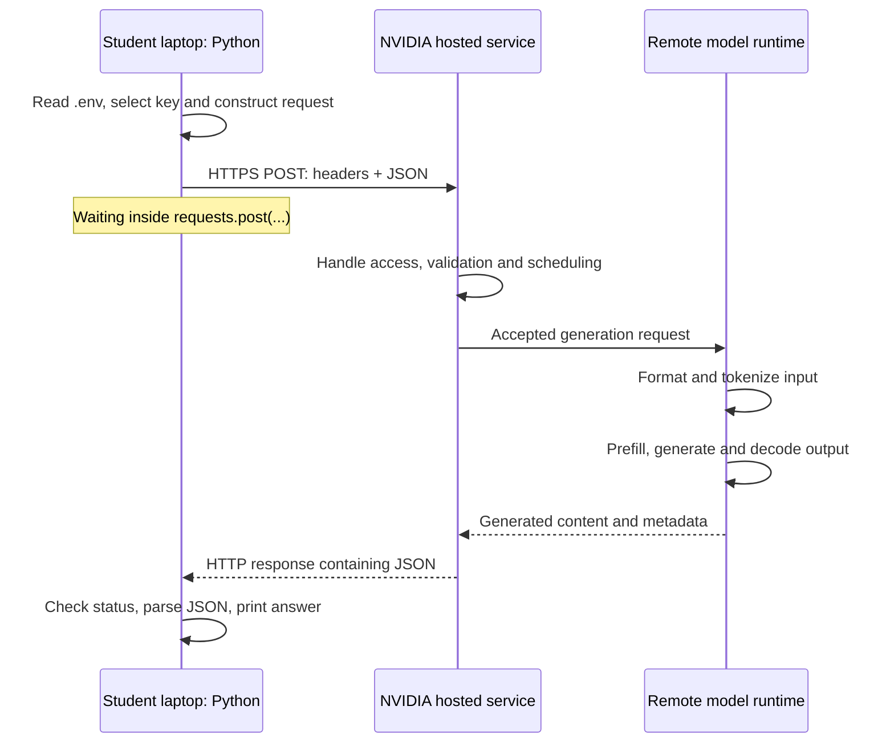

# NVIDIA Build account setup and inference walkthrough

Start with [HTTP and the Python Requests library](http_and_requests.md): what a request contains, why an independent Python package can communicate with NVIDIA, and how to inspect a request before sending it. Its offline exercise needs no account or key.

Read this alongside [nvidia_inference.py](src/eaas_llm_inference/nvidia_inference.py). The experiment runs a small Python client on your laptop and requests model inference from NVIDIA. **The LLM runs remotely while your Python program waits inside `requests.post(...)`.** A valid accepted request triggers that remote work; an authentication failure may prevent inference entirely.

The account instructions in section 2 combine public NVIDIA sources checked on **13 October 2026** with the instructor's registration experience reported on that date: **a phone number was required for verification, and registration involved repeated visual CAPTCHAs**. The report does not establish a fixed order or number of challenges for every account. The remaining technical material was checked on **11 October 2026**.

## 1. What you need

- A laptop with uv and an internet connection. Follow the [project setup](README.md) to prepare Python and the `requests` and `python-dotenv` packages in this project's `.venv`.
- Access to your email inbox and a phone that can receive the requested verification message when registering. Phone verification was required in the instructor's registration.
- The legal age of majority, 18 in Germany: NVIDIA's API Trial Terms of Service "can be accepted only by an adult of legal age of majority".
- An NVIDIA account with access to the selected hosted endpoint.
- A Build API key for your account.
- The standalone project in `llm_inference` and a public teaching prompt.

**Terms for your prompts.** NVIDIA's [Build page](https://build.nvidia.com/nvidia/nemotron-3.5-lightning-30b-a3b) states that its trial service "is governed by the NVIDIA API Trial Terms of Service" ([PDF](https://assets.ngc.nvidia.com/products/api-catalog/legal/NVIDIA%20API%20Trial%20Terms%20of%20Service.pdf), checked on 17 October 2026). They allow use "for internal testing and evaluation purposes" only, and let NVIDIA collect "User Content and Generated Content to improve NVIDIA products and services, including AI models", without identifying specific users. Send public teaching prompts only: no personal data, passwords, keys, confidential material or assessed work. [Who receives your prompt](openrouter_walkthrough.md#41-who-receives-your-prompt) compares this route with OpenRouter. Accepting these terms is your decision; if you decide against them, you need no NVIDIA account: use the offline exercises in [Classroom timing and blocked registration](#classroom-timing-and-blocked-registration).

The project requires Python 3.11 or newer; `.python-version` selects 3.13 by default. Its `pyproject.toml` declares the libraries, package build backend and commands, and `uv.lock` records resolved dependency versions. uv prepares the local environment and installs our package from `src/eaas_llm_inference/` in editable mode. This is client software for your laptop, not the remote model.

You do not install a model, CUDA, Docker or vLLM for this hosted experiment. NVIDIA describes its catalog endpoints as running in its DGX Cloud environment. [NVIDIA hosted API quickstart](https://docs.api.nvidia.com/nim/docs/api-quickstart).

## 2. Create the account and obtain a key

We will complete three tasks in order: **create a login identity → obtain access to Build → create a credential for Python**. An NVIDIA account password and a Build API key are different secrets. Your password signs you into the website; the key lets your program authenticate its requests.

Use the account-first route below. Keep your email inbox available in another tab and your phone ready for verification.

**Expect visual CAPTCHAs during registration.** The instructor encountered many of them. A CAPTCHA is a website challenge intended to check for human interaction, for example an image-selection task. Read and complete each challenge yourself, submit it using the control displayed, and continue when the website allows it. Further challenges may appear later in the flow; they are not necessarily confined to one registration step. If an accessible alternative is offered, students who need it can use that option.

Keep these checks separate:

| Check | What it establishes | What you do |
|---|---|---|
| Email verification | Access to the registered email inbox. | Use the emailed code or link. |
| Phone verification | Access to the supplied phone number. | Receive and enter the requested verification code. |
| Visual CAPTCHA | Completion of the website's human-verification challenge. | Complete the challenge shown on the page. |

None of these checks generates an LLM answer. Their codes and answers are not the Build API key. During a classroom demonstration, keep personal contact details, passwords, verification codes and API keys off the shared screen.

### 2.1. Start account registration

1. Open [NVIDIA's account login/registration page](https://developer.nvidia.com/login).
2. Find the heading **Log in or sign up for an NVIDIA account**. The page has an **Email** field and a **Next** button. Despite the `/login` address, this is also an entry point for new users.
3. Enter an email address whose inbox you can open during the exercise.
4. Click **Next**.

**What just happened?** You supplied the identity you want to use. You have not entered a prompt, selected a model or created an API key. NVIDIA uses the email to direct you to the appropriate account flow.

| What appears next | What it means | Your next action |
|---|---|---|
| A form to create an account/password | You are registering a new NVIDIA identity. | Continue with section 2.2. |
| A request to sign in with an existing password or identity provider | NVIDIA is directing this email to an existing sign-in method. | Complete that sign-in; then continue with section 2.4. |
| A verification screen for an unfinished registration | The identity still needs verification. | Continue with section 2.3. |

The first screen is publicly visible on the [NVIDIA Developer login page](https://developer.nvidia.com/login). NVIDIA's [Build quickstart](https://docs.api.nvidia.com/nim/docs/api-quickstart) also documents the email-first split between new-account creation and existing-account sign-in. These are branches, not instructions to create a second account.

### 2.2. Create the new NVIDIA account

For a new email/password account:

1. Enter a new password in the account-creation form. Meet the password rules displayed there.
2. If a confirmation field is present, enter the same password again.
3. Complete any additional fields marked as required on this form.
4. Read the account terms and privacy information. Complete the required agreement controls if you choose to register.
5. Submit the account-creation form. NVIDIA's identity documentation calls this button **Create Account**.

**Checkpoint:** you have submitted the account registration. If the next screen asks you to verify your email, registration is not yet finished.

The password/confirmation/terms sequence is documented for the shared NVIDIA identity in the [NVIDIA account-creation instructions within the NGC guide](https://docs.nvidia.com/ngc/latest/ngc-user-guide.html#signing-up-for-a-free-individual-ngc-org). That source illustrates the identity step; its later NGC organization and cloud-account setup steps are outside this exercise. Exact password rules and extra profile fields on the current Build route have not been independently observed.

### 2.3. Verify your email address

Verification proves that you can receive mail at the address you entered.

1. Leave the registration tab open and switch to your email inbox.
2. Open the NVIDIA verification message. If it has not arrived, check the spam/junk folder and check the address shown in the registration tab for a typo.
3. Complete the method requested by the message and registration screen:

| Verification method | Exact action |
|---|---|
| The website asks for an emailed code | Copy the code from the email, return to the verification field, paste it, and submit it using the screen's continuation button. |
| The email contains a verification link | Click the link and wait for the browser to confirm verification. Return to your original registration tab. |

4. Complete any remaining required profile fields. If communication preferences are offered, select your own preferences and submit that screen.
5. Continue until the verification request is cleared and you can sign in with the account you just created.

**Checkpoint:** you can sign into NVIDIA and your email verification is complete. This establishes your identity; it does not yet prove that hosted inference is enabled.

NVIDIA documents both code and link verification variants in its [identity onboarding guide](https://docs.nvidia.com/ngc/latest/ngc-user-guide.html). Its [Build example prerequisites](https://github.com/NVIDIA/workbench-example-downloadable-nim#prerequisites) also identify email verification as part of setup. Do not treat a verification code as your API key.

### 2.4. Sign into Build and complete its access requirements

1. Open the [Nemotron Build page](https://build.nvidia.com/nvidia/nemotron-3.5-lightning-30b-a3b).
2. If the page shows **Login**, click it and sign in with the NVIDIA identity you just created. If you already have a signed-in profile menu, continue from there.
3. In the **Build** view, locate **Prototype**, then click **Generate API Key**. This is the hosted-inference area used by our Python exercise.
4. If Build presents a Developer Program enrollment or profile step, complete it using this same account, reading the terms before you decide to enroll.
5. Complete the access-verification prompts before expecting to use the hosted API. Phone verification was required in the instructor's registration, and visual CAPTCHAs can interrupt the flow. Their position can differ from this teaching sequence.

**What is the Developer Program?** It is NVIDIA's free developer membership, associated with the account. It is not a second password, an API key or a GPU reservation. NVIDIA's Build quickstart says registration through its key flow includes Developer Program membership. An existing identity may still need to complete the service's onboarding. [Developer Program FAQ](https://www.nvidia.com/en-us/on-demand/faq/), [Build registration documentation](https://docs.api.nvidia.com/nim/docs/api-quickstart).

**Complete phone verification when prompted:**

1. Enter the phone number you can access, using the country-code and number fields as presented by the form.
2. Request the verification message using the displayed control.
3. Complete any visual CAPTCHA presented as part of this process.
4. Read the verification code received on your phone. An **OTP** is a one-time verification code.
5. Enter that code into the website's verification field and submit it.
6. Check that the website confirms verification or advances beyond that requirement before continuing to key creation.

Phone verification is a practical preparation requirement for this lab because it was required in the instructor's actual flow. The precise field labels, supported countries, challenge count and order may vary across accounts.

If verification fails, preserve the error text and use [NVIDIA's account-access support instructions](https://forums.developer.nvidia.com/t/resolving-account-access-issues/345920/1). NVIDIA directs affected users to `help@build.nvidia.com` with their registered email, relevant attempted phone number and error details. Send those details privately to support, not to the course's shared materials. For the current class block, continue with the offline request inspection and the short tokenization exercise below while access is unresolved.

**Checkpoint:** Build lets you proceed to key creation without an unresolved access-verification step. Being logged into the website alone is not this checkpoint.

### 2.5. Generate and keep the Build API key

1. If the preceding flow already displays a newly created key, copy that key; you do not need another one.
2. Otherwise, while signed into Build, open [Settings → API keys](https://build.nvidia.com/settings/api-keys). NVIDIA also documents the route **profile menu → Settings → API keys**.
3. Choose the key-creation action on that page.
4. If a name is requested, use something recognizable such as `eaas-week01`. If expiry choices are offered, read them and record the selected expiry for yourself. Exact field names/defaults are account-screen details, not assumptions in this guide.
5. Complete creation and copy the full secret while it is displayed. Save it privately, for example in a password manager; the complete value may not be shown again.

This is a **Build inference key**. NVIDIA documents these keys as typically starting with `nvapi-`; the prefix alone does not prove a key is valid. The account password, email code and any NGC registry key are different credentials. [NVIDIA's Build key instructions](https://docs.nvidia.com/nemo/retriever/26.5.0/extraction/api-keys/).

**Checkpoint:** you have created a Build API key and retained it privately. No LLM has run merely because the key was created. The first successful inference request will establish that the key and selected endpoint work together.

### 2.6. Use the key in the starter

The current starter reads a private `.env` in `llm_inference`, beside `pyproject.toml`. The shareable [.env.example](.env.example) documents the expected names with empty fields; `OPENROUTER_API_KEY` belongs to the [OpenRouter examples](openrouter_walkthrough.md):

```dotenv
NVIDIA_API_KEY=
OPENROUTER_API_KEY=
```

Create the private `.env` from this empty template and configure `NVIDIA_API_KEY` there; `OPENROUTER_API_KEY` can stay empty until the OpenRouter walkthrough. If it already exists in this project root, keep using it. Check the filename is `.env`, not `.env.txt`. Leave the tracked `.env.example` empty; the private `.env` is excluded from ordinary Git tracking. The saved credential does not include the word `Bearer`, which the script supplies when building the HTTP header.

Do not insert a real key into Python source or replace any source-code literal with one. `"NVIDIA_API_KEY"` is a configuration name; `api_key` is the variable populated at runtime. If private configuration is not yet available, use the offline request inspection exercise.

1. Open a terminal in the project folder and prepare the local Python environment:

```powershell
uv sync
```

uv creates `.venv` if needed, updates `uv.lock` if the project's requirements need it, installs the selected dependencies, and installs our own package in editable mode. This makes its modules importable and creates the commands declared in `[project.scripts]`. Editable mode uses the source files in this checkout, so edits take effect on the next run. uv prefers versions already recorded in the lockfile rather than upgrading simply because newer releases exist. Package setup can download software; it does not send your prompt to NVIDIA. See the [project README](README.md) if uv itself is not installed. [uv locking and syncing](https://docs.astral.sh/uv/concepts/projects/sync/).

Our classroom commands use uv's automatic lockfile updates. Adding the optional `--locked` flag to `uv sync` or `uv run` makes an outdated or missing lockfile an error instead. That stricter check is useful in automated checks, but is not needed for these exercises.

2. Once private configuration is available, run the script using that project environment:

```powershell
uv run nvidia-inference
```

uv runs the installed `nvidia-inference` command in the project environment. Its entry point is `eaas_llm_inference.nvidia_inference:main`: import that module, then call `main()`. The function reads `.env` from the project root, selects `NVIDIA_API_KEY`, and builds the authorization header. It does not ask for terminal input or use an environment-variable lookup. A missing or blank value stops the program locally before it sends a request. This local check cannot establish that a credential is valid; NVIDIA checks access when it receives the request. Otherwise the script prints that it is sending a request and waiting for the response.

For an explicit module invocation, `uv run python -m eaas_llm_inference.nvidia_inference` reaches the same `main()` function through the module's `if __name__ == "__main__"` block. The command above keeps the classroom invocation short; all inference code remains visible in [the source module](src/eaas_llm_inference/nvidia_inference.py).

On the expected completed response, you see HTTP 200 and the generated answer. An error at this point is a different stage from account registration; use the troubleshooting section below. The key is stored in your local `.env` and read into process memory. `.gitignore` excludes the file from ordinary Git tracking; it does not encrypt the file or exclude it from manually created ZIPs. Keep `.env` private and distribute only the empty `.env.example` template.

The [HTTP explanation](http_and_requests.md#51-choose-where-the-api-key-comes-from) traces the file, Python dictionary, string and header separately.

### Reference: the different NVIDIA names

| Name | Its role |
|---|---|
| NVIDIA account | Your login identity. |
| Developer Program | Free membership associated with development/prototyping access. |
| NVIDIA Build | The catalog, playground, hosted access and key-management interface. |
| Build API key | A secret bearer credential authorizing the HTTP request. |
| NGC / `nvcr.io` | NVIDIA's catalog/registry ecosystem used in deployment workflows. |
| NGC personal key | A separate credential for relevant registry/deployment operations. |

The key is sent in an HTTP authorization header. It is not part of the prompt and is not a model, tokenizer, GPU allocation or Python package. Someone holding it may be able to consume your account's allowance. Keep it out of source files, shared screenshots and submissions; manage expiry/revocation through the account's key controls.

**Free access is an access condition, not a performance guarantee.** NVIDIA offers developer prototyping access, and the selected page currently advertises a free endpoint. Model-specific limits and concurrent load can affect availability and waiting time. Rehearse one short request before teaching and check NVIDIA's current statements on limits (section 13); do not promise a universal credit balance or request rate. [NIM access options](https://docs.api.nvidia.com/nim/docs/run-anywhere), [NVIDIA FAQ on rate limits](https://forums.developer.nvidia.com/t/nvidia-nim-faq/300317).

For delayed account verification, students can inspect a request locally without an account. If the instructor supplies a response from an earlier run, label it as recorded evidence and state what it can establish. No purchase is part of this exercise.

### Classroom timing and blocked registration

Reserve **30 minutes of class time** for registration, verification and key creation. This is a teaching timebox, not a measured signup duration or a guarantee that everyone finishes. Students who finish early can inspect the model page and prepare their first request.

At the end of the timebox, students still blocked record the stage and error message without including secrets. They, and students who decided against NVIDIA's terms, continue with [offline request inspection](src/eaas_llm_inference/inspect_http_request.py), run as `uv run inspect-http-request`. Trace the prompt from the Python string to the JSON body, and explain why serializing JSON is different from tokenizing the model input. If a live instructor demonstration is available, students can inspect its response without receiving the instructor's key.

For a short tokenization exercise requiring no download, use the toy vocabulary `0 = "a"`, `1 = "b"`, `2 = " "`, with a rule that encodes one character at a time. Encode `"ab ba"` as `[0, 1, 2, 1, 0]`, then decode it. Explain why `"ac"` cannot be encoded without an additional rule for unknown characters. This illustrates the roles of vocabulary and encoding/decoding rules; it is not Nemotron's tokenizer and gives no evidence about the hosted model's actual token IDs or counts.

Account activation is not graded. Remaining access issues can be revisited in a later class block; completing registration outside class is not homework. Repeated CAPTCHA challenges or a missing verification message do not demonstrate a fault in the student's Python code.

## 3. Read the model page as a map

The main page combines documentation, a client interface and deployment instructions. These are different activities:

| Page choice | Meaning |
|---|---|
| **Build** | Request examples and deployment instructions. |
| **Playground** | Send prompts through a browser interface. |
| **Model Card** | Read architecture, evaluations, training, intended uses and licensing. |
| **Overview / ModelCard++** | Documentation views within the model card. |
| **API Reference** | Consult accepted fields, values and response formats. |
| **Prototype** | Call NVIDIA's hosted service. This is our starting path. |
| **Deploy → Linux with Docker** | Run a serving container on infrastructure you provide. |
| **Generate API Key** | Create a credential for authenticated requests. |

The [Build page](https://build.nvidia.com/nvidia/nemotron-3.5-lightning-30b-a3b), [Playground](https://build.nvidia.com/nvidia/nemotron-3.5-lightning-30b-a3b/playground) and [Model Card](https://build.nvidia.com/nvidia/nemotron-3.5-lightning-30b-a3b/modelcard) are separate views. The public playground exposes example prompts and a **Reasoning OFF/ON** choice. Do not infer additional controls from another model's playground.

### Python, LangChain, Node and Shell

These tabs change the client example. Python and Node use their respective runtimes; Shell uses a command-line HTTP client; LangChain adds a framework abstraction. All can address the same remote service. Selecting Python does not download a Python implementation of the neural network.

NVIDIA's Python example imports `OpenAI`, but explicitly sets a NVIDIA `base_url`. The library is an API client; the URL determines this request's destination. Our script exposes the HTTP call directly through `requests`. The sample's `extra_body` passes additional JSON fields through the SDK; our raw JSON places `chat_template_kwargs` directly in the body. [NVIDIA's client examples](https://build.nvidia.com/nvidia/nemotron-3.5-lightning-30b-a3b). [Section 14](#14-compare-the-same-request-with-the-openai-sdk) sends our request through that SDK and compares both clients.

When you are signed in, the page can fill your real key into its example code. Copy the code structure, never that `api_key` value: it belongs only in your private `.env`.

## 4. What the model labels mean

| Label | Interpretation |
|---|---|
| `nvidia/…` | The publisher namespace in this model identifier. |
| Nemotron | A model family, rather than the website or HTTP client. |
| `3.5-lightning` | The specific release/variant name. |
| `30B` | Approximately 30 billion total parameters. |
| `A3B` | Approximately 3 billion active parameters per token; not a 3B storage requirement. |
| `NVFP4` in the checkpoint name | A low-precision representation recipe; it does not change the parameter count. The documented implementation uses mixed precisions. |
| Context length up to `1M` | Advertised model sequence capacity, not an instruction to generate a million tokens. |
| Text input / text output | The supported modalities on this page. |

This model combines Mamba, mixture-of-experts and attention components. Save their derivation for a later class; initially distinguish the trained model from its serving system. [Official model card](https://build.nvidia.com/nvidia/nemotron-3.5-lightning-30b-a3b/modelcard).

The page's availability labels describe separate delivery options: **Free Endpoint** is hosted access, **Download** concerns deployable artifacts, and **Partner Endpoint** concerns another provider's offering. These labels can change. The selected page currently lists free hosted access and download as available, and a partner endpoint as unavailable. [Current availability](https://build.nvidia.com/nvidia/nemotron-3.5-lightning-30b-a3b).

Context capacity and generated-output limits are distinct. The hosted reference currently caps `max_tokens` at 32,768. Neither that value nor the model-card context label alone establishes the actual maximum prompt accepted by the deployed service. [Endpoint reference](https://docs.api.nvidia.com/nim/reference/nvidia-nemotron-3-5-lightning-30b-a3b-infer).

## 5. What lives where

| Component | Location in this exercise | Purpose |
|---|---|---|
| Browser | Student laptop | Account setup, documentation and optional playground. |
| uv, `pyproject.toml` and `uv.lock` | Student laptop | Prepare the local Python environment and its dependency versions. |
| `.venv/` | Project folder on the laptop | Hold this project's Python environment, installed dependencies and launchers for our own package. |
| `src/eaas_llm_inference/` | Source checkout on the laptop | Hold the Python modules imported by the editable installation. |
| Python process | Student laptop CPU | Construct the request and process the response. |
| `requests` | Installed Python package on the laptop | Handle HTTP communication. |
| `python-dotenv` / `dotenv_values` | Installed Python package on the laptop | Read the local `.env` configuration into a dictionary. |
| `.env` | Private file in the project root, beside `pyproject.toml` | Store the key between runs. |
| Prompt and request dictionary | Laptop memory, then transmitted to NVIDIA | Describe the requested generation. |
| API key | Local `.env`, then laptop memory; sent in an authorization header | Authenticate the request to the service. |
| API endpoint | NVIDIA service | Receive and handle authenticated requests. |
| Model weights and serving runtime | Remote deployment | Perform model inference. |
| Chat template and tokenizer used by the server | Remote serving system | Convert messages to model input. |
| Generated token state | Remote inference worker(s) | Maintain the sequence during generation. |
| Received response and `result` dictionary | Laptop memory after delivery | Inspect and display the returned data. |

A later tokenizer exercise can load a public tokenizer on the laptop. That would not move inference onto the laptop or prove that the server used exactly that tokenizer revision. This starter does not yet include a tokenizer viewer.



This is a conceptual service diagram, not a measured trace of NVIDIA's internal implementation. Authentication, routing and scheduling can be distributed across components; the request does not expose their exact order or topology.

## 6. Follow the Python execution

| Code | What happens | Location |
|---|---|---|
| `uv run nvidia-inference` | Check the project environment and run the installed command. Its entry point imports our module and calls `main()`. | Laptop; setup may download missing software |
| Imports | Load Python modules. | Laptop |
| `def main():` | Define the function; its body has not run yet. | Laptop |
| Installed command calls `main()` | Start the function through the entry point declared in `pyproject.toml`. | Laptop |
| `Path(__file__).resolve().parents[2]` | Locate the project root from the source module's absolute path. | Laptop |
| `project_root / ".env"` | Build the path to the private configuration file in that root. | Laptop |
| `dotenv_values(...)` | Parse that file into the `config` dictionary. | Laptop |
| `config.get("NVIDIA_API_KEY")` | Select the stored key; the following check rejects missing or blank values. | Laptop |
| `prompt = ...` | Store a string. Nothing has been sent. | Laptop |
| `json={...}` | Construct a dictionary containing messages and settings. | Laptop |
| `requests.post(...)` | Encode and transmit the request, then wait for the response body. | Laptop communicating with NVIDIA |
| Remote generation | The service runs the requested model if the request is accepted. | NVIDIA deployment |
| `if not response.ok: print(response.text)` | On an error status, display the service's explanation from the response body. | Laptop |
| `response.raise_for_status()` | Raise an exception for HTTP error status codes. | Laptop |
| `response.json()` | Parse the received JSON into Python objects. | Laptop |
| `choices[0]["message"]["content"]` | Extract the first returned assistant answer. | Laptop |
| `print(...)` | Display that answer. | Laptop |

Here, `__file__` identifies `src/eaas_llm_inference/nvidia_inference.py`; `resolve()` produces its absolute path. In `parents`, index 0 is `eaas_llm_inference`, index 1 is `src`, and index 2 is the `llm_inference` project root. This explicit path assumes our editable course checkout. It does not search for a file or read your terminal environment, and it is not intended as the configuration strategy for a wheel installed elsewhere. The [HTTP guide](http_and_requests.md#52-read-our-local-configuration-one-line-at-a-time) traces each expression.

The module also retains `if __name__ == "__main__": main()` for `python -m` execution. Importing it through the installed command does not enter that block; the launcher calls `main()` itself, once.

The script prints a message immediately before `requests.post(...)` and the HTTP status after it returns. The interval includes communication and service waiting as well as inference. Those two messages do not measure GPU execution time.

The starter demonstrates a normal **HTTP 200 completed response**. `raise_for_status()` checks HTTP errors; it does not validate the response's structure. For example, the API documents a **202 pending** result requiring later polling. That needs a different response-handling path; the starter does not implement it. [Requests response handling](https://requests.readthedocs.io/en/latest/user/quickstart/#json-response-content), [NVIDIA response statuses](https://docs.api.nvidia.com/nim/reference/nvidia-nemotron-3-5-lightning-30b-a3b-infer).

## 7. Read the request itself

The destination is `https://integrate.api.nvidia.com/v1/chat/completions`: HTTPS protects transport; the host names NVIDIA's service; the path selects its versioned chat-completion operation. **POST** sends data for the service to process. `model` is a service identifier, not a local file path or a request to install weights.

The `Authorization: Bearer ...` header authenticates the caller. `json=...` serializes the Python dictionary and supplies the JSON content type. Python `False` becomes JSON `false`. The transmitted object contains messages and generation settings; your source file and interpreter are not uploaded by this code. [Requests JSON requests](https://requests.readthedocs.io/en/latest/user/quickstart/#more-complicated-post-requests).

| Setting in our script | Meaning |
|---|---|
| `messages` | The conversation supplied for this request. Here it has one user message. |
| `max_tokens=256` | A ceiling on generated tokens, not words or a guaranteed answer length. |
| `temperature=1.0` | Sampling temperature; lower values concentrate sampling more strongly. |
| `top_p=0.95` | Retain a high-probability nucleus before sampling. |
| `stream=False` inside JSON | Request one completed response instead of incremental SSE events. |
| `enable_thinking=False` | Request this model's non-thinking mode; inference still happens. |
| `timeout=60` | Client connection/read timeout behavior. It is not a strict overall runtime cap or confirmed server cancellation. |
| `allow_redirects=False` | Keep the client from following a redirect automatically. |

`timeout` and `allow_redirects` are arguments to the local HTTP library. They are outside `json`, so they are not generation settings sent to the model. [Requests timeouts and redirects](https://requests.readthedocs.io/en/latest/user/quickstart/#timeouts).

For later experiments, the selected endpoint also documents `stop`, best-effort `seed`, and `reasoning_budget`. A budget of `-1` disables its enforcement; it does not disable reasoning. Change one setting at a time and inspect termination. Output logprobs and `top_k` are not promised by this model-specific schema. [NVIDIA request schema](https://docs.api.nvidia.com/nim/reference/nvidia-nemotron-3-5-lightning-30b-a3b-infer).

There are also two distinct uses of the word **stream**: the JSON field asks the service for streamed output; Requests' own `stream=True` argument controls when the local client consumes response bytes. Streaming still requires a parser and does not relocate inference. Network chunks need not correspond one-to-one to tokenizer tokens.

## 8. What happens behind the endpoint

At a conceptual level, the serving system performs these tasks:

1. **Prepare input.** Format the supplied messages using a chat template and tokenize the resulting sequence.
2. **Prefill.** Process the input sequence and establish the state needed for generation.
3. **Generate.** Compute distributions for continuations, apply the decoding policy, select tokens and update state until stopping.
4. **Prepare output.** Decode token IDs and serialize the response, including fields the service chooses to expose.

For attention components, reusable state includes key/value caches. This hybrid model also has recurrent Mamba state. A production engine can batch requests, use multiple accelerators or optimize generation through techniques such as speculative decoding. The introductory next-token loop describes the computation conceptually; it does not prescribe one GPU operation per network chunk.

Weights belong to the deployment. Serving workers normally load and reuse them across requests; our program does not start a fresh local model each time. The exact worker lifecycle, hardware, quantization, routing and caching of an individual hosted request are not established by the client code. NIM packages serving capabilities; an engine such as vLLM implements inference execution. [NIM introduction](https://docs.nvidia.com/nim/large-language-models/latest/introduction.html), [Nemotron architecture and serving examples](https://huggingface.co/nvidia/NVIDIA-Nemotron-3.5-Lightning-30B-A3B-NVFP4).

Chat-style roles are input formatting. A second independent call does not include the previous exchange unless your client sends that history or uses a separate documented stateful mechanism. The starter sends the one-message list shown in the file each time.

## 9. Interpret the Deploy section without running it

Deployment changes who operates the model server. In the hosted path, NVIDIA does. In the Docker path, a chosen machine runs the container and needs suitable hardware, drivers and resources. That machine could later be a university GPU server; the Python client could remain on a student's laptop. [NIM hosting options](https://docs.api.nvidia.com/nim/docs/run-anywhere).

| Docker example fragment | What it means |
|---|---|
| `export LOCAL_NIM_CACHE=...` | Define a host cache-directory variable in a Linux shell. |
| `mkdir -p ...` | Create the directory if absent. |
| `docker run` | Start a container from an image. |
| `-it` | Attach terminal input/output. |
| `--rm` | Remove the container after exit; mounted host files can remain. |
| `--gpus all` | Give the container access to the host's available GPUs. It creates none. |
| `--shm-size=16GB` | Configure shared memory, not 16 GB of GPU VRAM. |
| `-v host:container` | Mount the host cache at a container path. |
| `-p 8000:8000` | Publish the container's service port through the host. |
| `nvcr.io/nim/nvidia/...:latest` | Select a container image from NVIDIA's registry. `latest` is a movable tag. |

[Docker run reference](https://docs.docker.com/reference/cli/docker/container/run/). The registry is a place to obtain an image; it is not the inference URL. Container software, model weights, model architecture and API endpoint are distinct things.

The page's self-hosted example uses a local URL and a shorter model alias. In a real deployment, use its reported served-model name. For a service on the same machine, `http://localhost:8000/v1/chat/completions` is the clear client address. `0.0.0.0` commonly denotes a server listening on all interfaces; it should not teach students that every client can access the same server at that address. `localhost` always refers to the client's own machine.

## 10. Inspect one response

After a successful call, find these fields in the parsed `result` rather than memorizing one output string. Only the answer text, and a reasoning text if present, was generated by the model; the service adds everything else around it.

| Field | Question it answers | Produced by |
|---|---|---|
| `id`, and fields such as `object` or `created` if present | Which completion is this, and when was it created? | Service bookkeeping |
| `model` | Which model identifier did the response report? | Service |
| `choices[0].message.role` | Who is speaking? Here `"assistant"`. | Service label |
| `choices[0].message.content` | What answer text was returned? | **Model**: generated tokens, decoded into text by the service |
| A reasoning field, if present | What separate reasoning text was exposed? | **Model** |
| `choices[0].finish_reason` | Why did this generation end? `"stop"`: the model ended its answer or a stop sequence matched; `"length"`: `max_tokens` was reached. | Service, reporting the generation loop |
| `usage`, if present | What token counts did the provider report? | Service; `prompt_tokens` counts the formatted input, including chat-template tokens |

These fields are typical of this chat-completion format; the service decides which ones it returns. The HTTP status line, headers and the local Response object around the body are explained in [What comes back?](http_and_requests.md#7-what-comes-back).

There are three ways to look at the complete result:

- **Capture it.** `uv run capture-nvidia-response` sends the same request, prints the request as sent and the complete response, and saves both to `outputs/` with credential headers replaced by `<removed>`. The saved file can be opened later or shown in class.
- **Print it.** Temporarily add `print(result)` before the final print, run once and remove the line afterward. The parsed body contains no key.
- **Pause in the debugger.** Set a breakpoint on the final `print(...)` line and start **LLM: NVIDIA inference (live)**, as described in the [debugging guide](debugging.md#7-debug-the-live-request-safely). Click **Continue** past the pause on the module's first line. At the breakpoint, add `result` to **Watch** and expand `choices`, `0` and `message`, then `usage`. For readable JSON, enter `import json` and then `print(json.dumps(result, indent=2, ensure_ascii=False))` in the **Debug Console**; the output appears there. Expanding `response.content` instead shows only one long bytes value, because the body is structured only after `response.json()`. If NVIDIA returned an error status, the debugger normally stops at `raise_for_status()`; inspect `response.status_code` and `response.text` there.

**Keep the key out of view while debugging.** As soon as the debugger pauses after the key has been read, **Variables > Locals** displays `api_key` and the `config` dictionary in plain text, without expanding anything; `config` holds every entry of `.env`, including an OpenRouter key if you added one. Hovering over `api_key` in the editor and expanding `response.request.headers` reveal it as well. Collapse **Variables** before sharing your screen or taking a screenshot, and work with **Watch** and the **Debug Console**. If keys have been exposed, replace every key that was visible: revoke the NVIDIA key in NVIDIA Build, and archive an OpenRouter key ([OpenRouter walkthrough, section 5](openrouter_walkthrough.md#5-create-an-api-key)); then create new keys and update `.env`.

Absence and an observed empty string have different meanings. A returned reasoning explanation is generated text, not a dump of all hidden neural computation. A completed HTTP request is not evidence that the answer is correct. The selected service's exact response must be inspected; do not fabricate missing counts, probabilities or token IDs.

The prompt visualization comes later: load a public tokenizer locally to reconstruct input boundaries. That requires tokenizer artifacts, not model weights. The API's returned text can also be retokenized, but this cannot recover hidden control tokens or the original generation probabilities.

## 11. Short in-class investigations

1. **Locate execution.** Before running, label each statement laptop, network boundary, or remote work. Explain why the remote forward pass has no Python implementation in this file.
2. **Trace a datum.** Follow the prompt from the Python string into `messages`, the request body, the remote input and the printed reply. Locate the API key separately.
3. **Observe waiting.** Run once and watch the two status messages. State which parts of the elapsed time you cannot separate.
4. **Inspect a response.** Print the complete result, or run `uv run capture-nvidia-response`; locate answer, termination and any usage. Remove any extra print afterward.
5. **Change one variable.** Change the public prompt, or lower `max_tokens` once. Record the outcome and explain whether the response was complete. Avoid repeatedly retrying a limited endpoint.
6. **Explain deployment.** Describe what must change if the URL points to a university server instead. Does merely changing the URL deploy a model? No: that server must already exist.

Exit ticket: explain the difference between a model, a model server, a client library, a tokenizer, an API endpoint and an API key using this one run.

## 12. Diagnose the layer before changing the prompt

| Observation | First investigation |
|---|---|
| `uv` is not recognized | Install uv using the [project setup](README.md), then reopen the terminal. |
| `ModuleNotFoundError` or command not found | In `llm_inference`, run `uv sync`, then `uv run nvidia-inference` so the command uses the installed project and its environment. |
| uv reports an outdated lockfile when using `--locked` | The optional strict check prevented a lockfile update. For normal development, run `uv sync` to update it as needed; in an automated check, ensure the updated `pyproject.toml` and `uv.lock` were committed together. This is local project setup, not NVIDIA authentication. |
| Account verification cannot complete | Continue with the offline request inspection and toy tokenization exercise above while resolving access. |
| `NVIDIA_API_KEY is missing from the local configuration.` | Local configuration: the private `.env` must be available beside `pyproject.toml` and contain a nonblank entry under that name. The script has not sent a request. |
| HTTP 401 / 403 | Authentication, expiry, permissions or endpoint access. |
| HTTP 400 / 422 | Request fields, model identifier and accepted values. |
| HTTP 429 | Applicable quota, rate or capacity limit; inspect the response and wait before retrying. See [the free endpoint's limits](#13-understand-the-free-endpoints-limits). |
| HTTP 5xx | Service-side error or capacity; try again later. A 504 means no worker picked up the request in time. |
| `ReadTimeout` (`Read timed out`) | The connection worked and the request was sent, but no HTTP response arrived within the read timeout. Often service load; see [the free endpoint's limits](#13-understand-the-free-endpoints-limits). |
| `ConnectTimeout` or `ConnectionError` | No connection to NVIDIA: check the network before suspecting the service. |
| HTTP 202 | Pending work; this minimal script does not implement polling. |
| `choices` missing | Inspect status and response body before assuming a completion schema. |
| Empty/truncated answer | Inspect termination, output budget and any exposed reasoning. |

HTTP status is evidence about request handling, not a model-quality score. The account instructions include the instructor's reported registration experience; Python examples were checked offline during artifact preparation. Rehearse one real completed inference response before the class.

A traceback shows the failing layer. Read it from the bottom: in a `ReadTimeout`, the deepest frames are in `ssl` and `socket`, waiting for bytes, and above them `http.client` waits for the response's status line. The request had left the laptop, but no status line arrived.

## 13. Understand the free endpoint's limits

Free hosted access is meant for evaluation and prototyping. NVIDIA's documentation describes its limits only in general terms, and the site names a generic rate; measure what your own account experiences. The sources in this section were checked on **14 October 2026**; limits and free access can change.

**What NVIDIA documents.** NVIDIA's [NIM FAQ](https://forums.developer.nvidia.com/t/nvidia-nim-faq/300317) says the number of calls allowed in a period is "designed to serve evaluation and prototyping needs only", that the rate "will vary per model queried and may vary based on the number of concurrent users", and that "you may experience extended wait times during periods of high load". The documentation gives no number. The [endpoint reference](https://docs.api.nvidia.com/nim/reference/nvidia-nemotron-3-5-lightning-30b-a3b-infer) documents status 202 as "Result is pending. Client should poll using the requestId", with the request ID in the `NVCF-REQID` header. NVIDIA's [Cloud Functions troubleshooting](https://docs.nvidia.com/nvcf/overview/generic-http-function-invocation.md) explains status 504 as "No worker picked up the request within the polling timeout window."

**What the site says.** Once your account can generate API keys, the account menu at the top right of build.nvidia.com shows the API rate limit as "Up to 40 rpm", that is, up to 40 requests per minute, with the note "Rate limits may vary by model and traffic from other users may cause throttling." This text is built into every page, also for visitors who are not signed in, so it is a general statement, not a measurement of your account.

**What is reported, but not official.** Developer reports describe HTTP 429 when the limit is exceeded. In the [NVIDIA developer forum](https://forums.developer.nvidia.com/t/request-for-nvidia-build-api-rate-limit-increase-to-300-rpm-business-use/383589), one developer reports about 150 requests per minute on another model, so limits differ by model. A moderator reply quoted there describes the limit as "dependent on model, use-case and the amount of current overall traffic" and says there is "no official way" to raise it on the free tier. Treat any number as an observation, not a promise; only your own requests show what applies to you.

**What we observed.** Two identical requests from the same account: one completed in about 0.7 seconds on 13 October 2026; a later one received no response within the starter's 60-second read timeout and ended with `requests.exceptions.ReadTimeout` on 14 October 2026. The same code and key can succeed quickly or wait in vain, depending on the service's load.

| Symptom | Layer | Meaning |
|---|---|---|
| `ConnectTimeout` or `ConnectionError` | Network, before HTTP | No connection; the request was not processed. Check the network. |
| `ReadTimeout` | After sending, before any HTTP response | No status line arrived within the read timeout. A busy free endpoint can keep requests waiting. Our client gave up, so we do not know what the service would eventually have answered. |
| HTTP 202 | HTTP response | Accepted but still pending; the result must be polled using `NVCF-REQID`. The course scripts do not poll. |
| HTTP 429 | HTTP response | Too many requests: a rate or capacity limit applied. Wait, at least as long as a `Retry-After` header says, if present. |
| HTTP 504 | HTTP response | No worker picked up the request in time. Try again later. |

**Where the explanation of a failure comes from.** The service checks the key, the request fields and the limits before the model runs. A rejected request therefore returns quickly, and the model never runs: the status names the category, and the body usually explains the reason. The starter prints that body before raising its exception. A timeout carries no explanation at all, because no response arrived.

**Can you see how close you are to the limit?** Some providers send rate-limit headers, such as `x-ratelimit-remaining-requests`, with every response. NVIDIA documents no such header and no endpoint that reports the remaining quota, so on the free tier you typically learn about a limit only when a request is rejected; the account menu shows only the site's generic figure. Whether NVIDIA's responses contain such headers anyway can be checked: `uv run capture-nvidia-response` prints every response header and ends with one line naming any `Retry-After`, rate-limit or `NVCF-` headers. It also saves runs that ended without any response, together with the time waited. Every run is a real request that counts against your limits: space runs out and never retry in a loop.

The starter has no retry logic. Polling pending results, honoring rate limits and retrying belong in later, more robust clients.

## 14. Compare: the same request with the OpenAI SDK

NVIDIA's Python example uses the `openai` package. [nvidia_inference_openai.py](src/eaas_llm_inference/nvidia_inference_openai.py) sends our starter's request through that SDK:

```console
uv run nvidia-inference-openai
```

Read it side by side with [nvidia_inference.py](src/eaas_llm_inference/nvidia_inference.py). The prompt, the settings and the private `.env` reading are identical; only the client library differs. In VS Code, **LLM: NVIDIA inference via OpenAI SDK (live)** runs it under the debugger; see the [debugging guide](debugging.md#7-debug-the-live-request-safely).

| Step | Requests starter | OpenAI SDK |
|---|---|---|
| Destination | Full URL in the call | `base_url`; the SDK appends `/chat/completions` |
| Credential | We build `Authorization: Bearer ...` | `api_key=`; the SDK builds the same header |
| Body | One `json=` dictionary | Keyword arguments; fields outside OpenAI's schema, such as `chat_template_kwargs`, go into `extra_body` and are merged into the same JSON body |
| Other headers | Requests' four defaults, such as `User-Agent: python-requests/...` | `User-Agent: OpenAI/Python ...` plus `X-Stainless-*` headers that report the SDK version, operating system, CPU architecture and Python version |
| Status code | `response.status_code` | Not shown on success; available through `client.chat.completions.with_raw_response`. An error status raises an exception such as `openai.RateLimitError` |
| Error explanation | The starter prints `response.text` | Included in the exception message |
| Answer | `result["choices"][0]["message"]["content"]` on dictionaries | `completion.choices[0].message.content` on typed objects |
| Timeout | `timeout=60` | Default read timeout 600 s; our script sets 60 |
| Retries | None | Default: 2 automatic retries on timeouts, connection errors, 408, 409, 429 and 5xx; our script sets `max_retries=0` |
| Redirects | `allow_redirects=False`: not followed | Followed by the SDK's default HTTP client; NVIDIA's endpoint does not normally redirect |
| Implicit configuration | None | Reads `OPENAI_API_KEY` and `OPENAI_BASE_URL` when values are not passed. Even with both passed, `OPENAI_ORG_ID` and `OPENAI_PROJECT_ID` are read and, if set, sent as `OpenAI-Organization` and `OpenAI-Project` headers. Every `Name: value` line of `OPENAI_CUSTOM_HEADERS` is also sent as a header; an `Authorization` line there replaces the key from `api_key` |
| Dependencies | `requests` | `openai`, plus `httpx2`, `pydantic`, `anyio`, `jiter` and others |

The defaults were read from `openai` 3.29.0 on 14 October 2026; check them again after an upgrade.

**"OpenAI" names the API format, not the destination.** NVIDIA's service accepts the OpenAI-compatible chat-completions format, so this client library can talk to it. `base_url` decides where the request goes: nothing is sent to OpenAI, and no OpenAI account is involved. Compatible does not mean identical: NVIDIA-specific fields need `extra_body`, and accepted values follow NVIDIA's [endpoint reference](https://docs.api.nvidia.com/nim/reference/nvidia-nemotron-3-5-lightning-30b-a3b-infer).

**Automatic retries matter on the free tier.** With its defaults, the SDK silently repeats a request when NVIDIA answers 429 or a 5xx, and also after a timeout or a connection error. In an offline test with a mocked 429 response, one call produced three requests within about a second, and the program reported only the final failure. Each request counts against your limit, and a silent endpoint could keep a default call waiting for three attempts of 600 seconds each. Our script therefore sets `max_retries=0`, so both examples send one request per call.

**What stays the same.** Both programs run locally, send one HTTPS request with a JSON body to the same endpoint and wait while NVIDIA's model runs. The SDK saves code; it changes neither the essential message nor where the model runs. Use the Requests starter to see the HTTP mechanics, and an SDK when an application benefits from typed responses, built-in retries and streaming helpers.

NVIDIA's own example also enables thinking, requests up to 16,384 tokens and streams the answer with `stream=True`, printing reasoning text as it arrives. Streaming and reasoning output are separate topics for a later example.

The same model is also available through OpenRouter, a service that forwards requests to model providers. The [OpenRouter walkthrough](openrouter_walkthrough.md) sends this prompt that way, with OpenRouter's model identifier and its own thinking switch, and compares both services.
