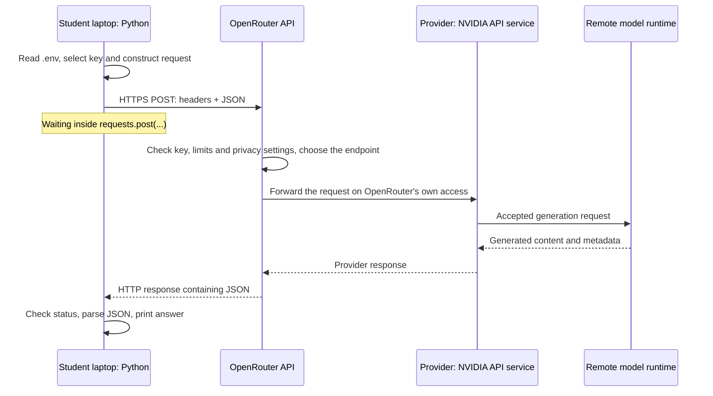

# OpenRouter account setup and inference walkthrough

This walkthrough sends the prompt and settings of the request in the [NVIDIA walkthrough](nvidia_walkthrough.md) to the same model a second way: through **OpenRouter**, a service that forwards requests to model providers. Read it alongside [openrouter_inference.py](src/eaas_llm_inference/openrouter_inference.py). [HTTP and the Python Requests library](http_and_requests.md) explains the request itself; its offline exercise needs no account.

The facts in this guide were checked on **17 October 2026** against OpenRouter's documentation, its public model and provider data, its terms and NVIDIA's terms. OpenRouter shows its sign-up window, its first-time dialog, its key dialog and its privacy settings only during sign-up or after signing in. Their labels below come from OpenRouter's documentation and public site code, and in places from user reports; the guide says which. They have not yet been checked in a course run-through. If your screen differs, follow the meaning of a step rather than its exact words. Free access, limits and data policies can change; this guide does not promise that the free variant stays available or free.

## 1. What OpenRouter adds between your laptop and the model

OpenRouter runs no models itself. It offers one OpenAI-compatible API in front of many model providers and forwards each request to one of them: "OpenRouter is a proxy that sends your requests to the model provider for it to be completed." [OpenRouter FAQ](https://openrouter.ai/docs/faq). When a model has several providers, OpenRouter chooses among them, by default "prioritizing price" and avoiding providers with recent outages. [Provider routing](https://openrouter.ai/docs/guides/routing/provider-selection).

Our model identifier is `nvidia/nemotron-3.5-lightning:free`. The suffix `:free` selects a separate free variant "with its own rate limits and endpoints". [Model variants](https://openrouter.ai/docs/guides/routing/model-variants/overview). An **endpoint** is one provider's offering of a model. On 17 October 2026 the free variant had exactly one: provider NVIDIA, quantization NVFP4, price 0, a context of 1,000,000 tokens and at most 65,536 output tokens. [Endpoint list](https://openrouter.ai/api/v1/models/nvidia/nemotron-3.5-lightning:free/endpoints); this public JSON opens in a browser without an account.

| What OpenRouter adds | What it means for our request |
|---|---|
| One API and one key for many providers | The same URL and key reach models from many companies. |
| Routing | OpenRouter selects the endpoint. Our free variant has only one, so nothing can take over when NVIDIA's endpoint fails. |
| Its own limits | Free variants allow 20 requests per minute and 50 per day ([section 10](#10-understand-the-free-model-limits)). |
| Account settings | Privacy switches decide which providers may receive your requests ([section 4](#4-set-the-privacy-switches-before-the-first-request)). |
| A normalized response | Extra fields such as `provider` and `usage.cost` ([section 9](#9-inspect-one-response)). |

**Is it really the same model as in the NVIDIA example?** NVIDIA serves both routes. OpenRouter's provider data, an undocumented JSON that its documentation pages load, names NVIDIA's API address `https://integrate.api.nvidia.com/v1`, the host our NVIDIA starter calls directly. Both sides label the model NVFP4. However, OpenRouter's page data shows its own upstream model identifier, and the output limits differ: NVIDIA's endpoint reference caps `max_tokens` at 32,768, while OpenRouter lists 65,536. Neither side states whether both routes reach the same deployment. The comparison is therefore **NVIDIA directly versus NVIDIA through a router**: one provider, not two, although the two routes may be served by different NVIDIA deployments.

The paid variant `nvidia/nemotron-3.5-lightning` is a different case. On 17 October 2026, four other providers served it, mostly in BF16 or INT4, and NVIDIA was not among them. This guide uses only the free variant.



This is a conceptual diagram, not a measured trace. Your OpenRouter key authenticates you to OpenRouter only. Unless you add a key of your own for the provider (BYOK, *bring your own key*), OpenRouter calls the provider on its own capacity and manages the provider's limits. [BYOK](https://openrouter.ai/docs/guides/overview/auth/byok).

## 2. What you need

- A laptop with uv and the prepared `llm_inference` project ([project README](README.md)).
- A browser, and an e-mail address you will keep, or a Google or GitHub account. OpenRouter's sign-up asks for no phone number.
- An age of at least 18 years. OpenRouter's [Terms](https://openrouter.ai/terms) require it, and the [NVIDIA API Trial Terms of Service](https://assets.ngc.nvidia.com/products/api-catalog/legal/NVIDIA%20API%20Trial%20Terms%20of%20Service.pdf), which apply to the free endpoint, "can be accepted only by an adult of legal age of majority".
- No payment method: free variants work on OpenRouter's Free plan. [Pricing](https://openrouter.ai/pricing).
- Your own decision whether to allow a free endpoint that may train on your prompts: through OpenRouter, the course model is reachable only with it ([section 4](#4-set-the-privacy-switches-before-the-first-request)). If you decide against it, you need no OpenRouter account; use the exercises in [section 15](#15-classroom-timing-and-blocked-registration).
- A public teaching prompt ([section 4.2](#42-what-you-send)).

No GPU, model download or Docker is needed; the model runs at the provider.

## 3. Create the account

We complete three tasks in order: **create the account → set the privacy switches → create a key for Python**. Your password, or your Google or GitHub sign-in, signs you into the website; the API key lets your program authenticate its requests. They are different secrets. During a classroom demonstration, keep e-mail addresses, passwords, verification codes and keys off the shared screen.

Unlike the NVIDIA registration, OpenRouter's publicly readable sign-in configuration had neither phone verification nor a CAPTCHA switched on, on 17 October 2026. Both can change at any time.

### 3.1. Register

Choose the e-mail address before you start. OpenRouter rejects disposable addresses and addresses with a plus tag, such as `name+course` before the `@`. Its sign-in configuration also marks the address as one that users cannot change themselves, so register with an address you want to keep.

1. Open [openrouter.ai](https://openrouter.ai/) and click **Sign Up** at the top right. A sign-up window opens on the same page; [openrouter.ai/sign-up](https://openrouter.ai/sign-up) shows the same form as a separate page.
2. Register in one of two ways:
   - **With an e-mail address:** enter the address and a password; first and last name are optional. Read the linked documents, tick the box that agrees to the **Terms of Service**, **Privacy Policy** and **Model Terms**, then click **Continue**.
   - **With Google or GitHub:** click its button, which may show only the logo, and sign in there. Back on OpenRouter, tick the same box when it is shown and continue.

Model Terms are the providers' own terms; for our free model, NVIDIA's API Trial Terms of Service.

**What just happened?** You created a login identity. You have not chosen a model, created a key or sent a prompt. The **Sign Up** button is visible on OpenRouter's public page; the form's other labels come from its site code.

### 3.2. Verify your e-mail address

This step applies only to registration with an e-mail address.

1. Leave the sign-up tab open and open OpenRouter's message in your inbox. If it has not arrived, check the spam or junk folder and the address you typed.
2. Click the verification link **in the same browser on the same device** where you started the sign-up; opened elsewhere, for example on your phone, the link reports that it is invalid for that device. If the screen asks for a code instead, copy it from the message and submit it.
3. Return to the sign-up tab.

**Checkpoint:** you are signed in. Neither the link nor a code is your API key.

If registration stalls, for example because no message arrives, note the stage and the error message without secrets and continue with the exercises in [section 15](#15-classroom-timing-and-blocked-registration). Take account problems privately to OpenRouter's support, as its [FAQ](https://openrouter.ai/docs/faq) describes, and never send a key.

### 3.3. Get through the first-time dialog

OpenRouter's site code shows a short dialog for new accounts; your screens may differ. Keep this dialog off shared screens, because it displays a key.

1. **How will you be using OpenRouter?** Choose **Individual**.
2. **Your workspace is ready** creates a first key named **Default key**, with a credit limit of $100 and an expiry of 180 days. A credit limit is a cap, not a charge: with no credits on the account, nothing can be spent. The **Your API Key** box shows only the key's first and last characters; the copy button beside it copies the complete key. You do not need this key: [section 5](#5-create-an-api-key) creates a course key after your privacy decision. If you want to keep this one instead, click the copy button and paste the key into your private `.env` ([section 6](#6-put-the-key-into-the-private-env)) before you close the dialog.
3. Do not run, paste or save the "Make your first request" example below the key. It contains your complete key; terminals and the Python prompt keep pasted lines in history files; and running it would send a request before your privacy decision in section 4.
4. **Add a payment method** is not needed for free models: choose **I'll do this later**.
5. Answer or skip the remaining questions, then choose **Go to Dashboard**.

**Checkpoint:** you reach OpenRouter's dashboard without having entered payment details. If others saw the key, archive **Default key** as described in [section 5](#5-create-an-api-key).

## 4. Set the privacy switches before the first request

OpenRouter checks every request against your account's privacy settings before forwarding it. NVIDIA, the only provider of our free variant, appears in OpenRouter's provider table as a provider that **may train** on prompts and **retains prompts** for an unknown period. [Provider logging](https://openrouter.ai/docs/guides/privacy/provider-logging). If your settings exclude such providers, OpenRouter cannot route the request, and it fails before NVIDIA receives it. OpenRouter's [guide for this model](https://openrouter.ai/nvidia/nemotron-3.5-lightning:free/llms.txt) lists "404 — unknown model or no provider can serve the request", and user reports from 2025 and 2026 show a 404 whose message mentions your data policy or guardrail restrictions. OpenRouter's general [error list](https://openrouter.ai/docs/api_reference/errors-and-debugging) names 503 for "no available model provider that meets your routing requirements", so a 503 is possible too.

Read 4.1 and 4.2 before you change anything: section 4.3 asks for your decision.

### 4.1. Who receives your prompt

| Party | What it states about your request |
|---|---|
| OpenRouter | It "does not store your prompts or responses, *unless* you opt in", but stores metadata such as token counts and latency for each request. It also samples a small number of prompts for anonymous categorization, which feeds its rankings. [Data collection](https://openrouter.ai/docs/guides/privacy/data-collection) |
| NVIDIA, free endpoint | The notice on the model page: "Your use is logged for security purposes and to improve NVIDIA products and services." NVIDIA's Trial Terms let it collect "User Content and Generated Content to improve NVIDIA products and services, including AI models", without identifying specific users, and allow use "for internal testing and evaluation purposes" only. [Model page](https://openrouter.ai/nvidia/nemotron-3.5-lightning:free/providers), [Trial Terms](https://assets.ngc.nvidia.com/products/api-catalog/legal/NVIDIA%20API%20Trial%20Terms%20of%20Service.pdf) |

These are the companies' own statements; our code cannot verify them. For the **Data Policy** tag on its model pages, OpenRouter says: "This is not a definitive source of third party data policies, but represents our best knowledge." [Provider routing](https://openrouter.ai/docs/guides/routing/provider-selection).

**How you are identified.** For providers that require a user identity, OpenRouter sends them a hashed identifier, by default one per account. [User tracking](https://openrouter.ai/docs/cookbook/administration/user-tracking). OpenRouter's undocumented provider data marks NVIDIA as such a provider. Under its Terms, section 6.8, OpenRouter also tries to pass on the country of your request. Your account data, the e-mail address and any name you gave, is processed by OpenRouter, whose [privacy policy](https://openrouter.ai/privacy) says that personal data "may be transferred to our servers in the US".

**The same NVIDIA conditions apply to NVIDIA Build.** NVIDIA's Build page states that its trial service "is governed by the NVIDIA API Trial Terms of Service". OpenRouter's switch does not create the condition; it asks you to confirm it.

NVIDIA's data centers are listed in the US. OpenRouter's EU in-region routing exists only on its Business and Enterprise plans ([In-region routing](https://openrouter.ai/docs/guides/features/in-region-routing)), and the [model page](https://openrouter.ai/nvidia/nemotron-3.5-lightning) says this model is not available through it.

### 4.2. What you send

Send public teaching prompts only: no personal data about yourself or others, no passwords or keys, no confidential or unpublished material, no assessed work. NVIDIA's notice for this endpoint asks you to "not upload any confidential information or personal data".

### 4.3. Decide, then set each switch

**Decide first.** Allowing a provider that may train on your prompts is your decision; the NVIDIA starter falls under the same NVIDIA terms. The switch applies to your whole account, not only to the course model: on 17 October 2026, 11 of the 16 free text models in OpenRouter's default model list had an endpoint that may train. You can switch it off again later, for example when the course no longer needs it; prompts already sent stay under NVIDIA's terms. If you decide against it, still carry out steps 1 to 3 below with this switch off, because its default is not documented. Then archive the first-time dialog's **Default key** as described in [section 5](#5-create-an-api-key), because an unused key is still a valid credential; if you pasted it into `.env`, delete that line. Continue with [section 15](#15-classroom-timing-and-blocked-registration).

1. Open **Settings → Privacy** ([openrouter.ai/settings/privacy](https://openrouter.ai/settings/privacy)).
2. Set the switches as in the table below. OpenRouter's documentation describes these settings without naming their labels. The labels below were reported in one community issue on 24 September 2026; they match the wording of OpenRouter's guardrail API, for example "allows free endpoints that train on request data". Defaults for new accounts are not documented, so check every switch.
3. Click **Save changes**. The same report says that flipping a switch alone does not store it.

| Switch (reported label) | What it controls | For this course |
|---|---|---|
| **Allow free endpoints that train on request data** | Whether free endpoints whose provider may train on your prompts can receive your requests. | **On** only if you decided to use this route; with it off, the course model is unreachable. |
| **Allow free endpoints that publish prompts** | Free endpoints that may publish prompts. | Off: OpenRouter's undocumented provider data marks NVIDIA as not publishing prompts, so the course model does not need it. |
| **Allow paid endpoints that train on request data** | The same for paid models. | Off: the course uses no paid models. |
| **Allow 1% data discount in workspaces** | Whether OpenRouter may use your prompts and completions to improve its product, for a 1% discount. | **Off**. It is off by default. |
| Zero Data Retention (ZDR), one switch per model group | Routing only to endpoints that keep no data. | Off for **All other models**: NVIDIA's free endpoint retains prompts and would be excluded. |

OpenRouter's pricing table lists "Data Policy-Based Routing" as not included on the Free plan, the plan you are on without a purchase; how this affects these switches is not documented. If a switch is missing or cannot be changed, note it and continue: your first request shows whether the course model is reachable ([section 11](#11-diagnose-a-failed-request)).

Keep the discount off. On free requests it saves nothing, since 1% of $0 is $0, and under OpenRouter's [Terms](https://openrouter.ai/terms), section 6.2, opting in grants OpenRouter a "perpetual, irrevocable" licence to the logged content, which includes selling it in anonymized form. OpenRouter states that it "has never shared, sold, or licensed underlying prompt data to any third party". The documentation places this option in different settings pages; wherever you find it, leave it off.

A separate option, **Input & Output Logging** in the workspace's **Observability** settings, stores your prompts and answers for you to review. The data is "retained for a minimum of 3 months", and longer at OpenRouter's discretion unless you request deletion. It is off by default; leave it off. [Data collection](https://openrouter.ai/docs/guides/privacy/data-collection), [Input & Output Logging](https://openrouter.ai/docs/guides/features/input-output-logging).

**Checkpoint:** the switches are set as you decided and saved.

## 5. Create an API key

If you copied the key from the first-time dialog, you can use it. This section creates a key with your own settings.

1. Open the **Keys** page. The button **Get API Key** on OpenRouter's home page leads there, as does [openrouter.ai/workspaces/default/keys](https://openrouter.ai/workspaces/default/keys). Older links such as `openrouter.ai/settings/keys` redirect to it.
2. Click **Create API Key**. OpenRouter's documentation uses this name; a tutorial from June 2026 shows **Create**.
3. Enter a recognizable name, such as `eaas-openrouter`.
4. Set a **Credit limit**. OpenRouter recommends a limit on every key. Free requests cost 0 credits, so a small limit such as 1 does not block them; it caps what the key could spend if your account ever holds credits.
5. If an expiration date is offered, choose one after the end of the semester. An expiry cannot be changed later.
6. Confirm. OpenRouter may first ask for your password or an e-mail code again.
7. Copy the complete key while it is displayed and paste it into your private `.env` straight away ([section 6](#6-put-the-key-into-the-private-env)). OpenRouter shows it only once. Its keys start with `sk-or-v1-`.

**Checkpoint:** you have created a key and stored it privately. No model has run yet. If you did not keep the first-time dialog's **Default key**, archive it now, as described below: an unused key is still a valid credential.

**If a key leaks.** "OpenRouter is a GitHub secret scanning partner" and e-mails you if it determines that a key has been compromised; do not rely on this for a key shown in a screenshot, a chat or a ZIP file. Archive an exposed key in **Settings → Security** ([openrouter.ai/settings/security](https://openrouter.ai/settings/security)): archiving is permanent, while disabling can be undone. Then create a new key and update `.env`. [Authentication](https://openrouter.ai/docs/api_reference/authentication), [Security settings](https://openrouter.ai/docs/guides/overview/auth/security-settings). Under OpenRouter's Terms you are "responsible for all activity and charges under its account or API Credentials, whether or not authorized by you".

**One account per person.** The Terms prohibit creating "multiple accounts as a single user, for purposes of bypassing or circumventing use limits on the Site or Service or for any other reason". If you already have an OpenRouter account, use it for the course. Further keys do not raise any limit.

### Reference: the different OpenRouter names

| Name | Its role |
|---|---|
| OpenRouter account | Your login identity. |
| Workspace | Holds your keys; every account has a **Default** workspace. |
| API key | A secret bearer credential for your requests, starting with `sk-or-v1-`. |
| Credits | A prepaid US-dollar balance for paid models; not needed for free variants. |
| Provider | The company whose endpoint runs the model, here NVIDIA. |
| Endpoint | One provider's offering of one model, with its own price and limits. |

## 6. Put the key into the private `.env`

The tracked [.env.example](.env.example) declares both configuration fields with empty values:

```dotenv
NVIDIA_API_KEY=
OPENROUTER_API_KEY=
```

Store the real key only in your private `.env` in `llm_inference`, beside `pyproject.toml`. If `.env` already holds your NVIDIA key, add the OpenRouter line to it; do not create a second file.

1. In VS Code, use **File > Open Folder** and open the repository folder or `llm_inference`.
2. In the **Explorer**, open `.env` in `llm_inference`; if you opened `llm_inference` itself, it is the first file below the folders, such as `.venv`, `.vscode` and `src`. If it does not exist, right-click `.env.example` and choose **Copy**, then right-click `.env.example` again and choose **Paste**: the copy appears in the same folder. Right-click the copy, choose **Rename** and name it `.env`.
3. Paste the key directly after `OPENROUTER_API_KEY=`: no quotes, no spaces and no `Bearer`. If your `.env` has no such line, because you created it from the earlier one-line template, type `OPENROUTER_API_KEY=` on a new line first. Keep the `NVIDIA_API_KEY` line as it is.
4. Save with **File > Save**.

| Where you work | What to watch |
|---|---|
| Windows | Editors such as Notepad can save `.env.txt`; VS Code saves the exact name. To see extensions in File Explorer, use **View > Show > File name extensions** (Windows 11). |
| macOS | Finder hides names that start with a dot; VS Code's Explorer shows `.env`. Optionally, **Cmd+Shift+.** shows hidden files in Finder. |
| Ubuntu / other Linux | File managers hide dot-files; VS Code shows them. Optionally, **Ctrl+H** shows hidden files in most file managers. |
| WSL | WSL is its own Linux environment: a checkout inside WSL needs its own `.env`. |

`.env` is plain text. `.gitignore` keeps it out of ordinary Git tracking, but it is neither encrypted nor excluded from a ZIP you make yourself. Never put the key into Python source, a launch configuration, a chat message or a screenshot, and never save the first-time dialog's example code, which already contains it. The [HTTP guide](http_and_requests.md#52-read-our-local-configuration-one-line-at-a-time) traces how the file's value becomes a header.

## 7. Run the Requests example

Before your first run, open the endpoint list ([section 10](#10-understand-the-free-model-limits)); this sends no request. If `uptime_last_5m` is low, the endpoint has been failing in the last few minutes: wait a few minutes before you run. No value promises an answer, and `uptime_last_1d` describes the past day, not the present. An answer can take close to a minute: wait for the second line instead of interrupting and starting again. From `llm_inference`:

```console
uv sync
uv run openrouter-inference
```

`uv sync` installs the new command once; afterwards `uv run openrouter-inference` is enough. The program prints:

```text
Sending request to OpenRouter; waiting for the response...
Received HTTP 200 from OpenRouter.
```

followed by the model's one-sentence answer, which differs between runs. HTTP 200 shows that the exchange worked; it does not show that the answer is correct. Any other output belongs to a later stage than registration: look it up in [section 11](#11-diagnose-a-failed-request) before you run again, because every attempt counts against your daily limit.

The script reads `OPENROUTER_API_KEY` from `.env`; a missing or blank value stops it locally, before any request. `uv run python -m eaas_llm_inference.openrouter_inference` runs the same `main()` function explicitly. In VS Code, **LLM: OpenRouter inference (live)** starts it under the debugger ([section 14](#14-debug-without-exposing-keys)).

## 8. What the request changes compared with the NVIDIA starter

Open both files in a comparison view: in the **Explorer**, right-click [nvidia_inference.py](src/eaas_llm_inference/nvidia_inference.py) and choose **Select for Compare**, then right-click [openrouter_inference.py](src/eaas_llm_inference/openrouter_inference.py) and choose **Compare with Selected**. The structure, the prompt and the settings `max_tokens`, `temperature`, `top_p` and `stream` are identical. Apart from the docstring, the comments and the service's name in printed messages, these lines differ:

| | NVIDIA starter | OpenRouter version | Why |
|---|---|---|---|
| Configuration name | `NVIDIA_API_KEY` | `OPENROUTER_API_KEY` | Each service issues its own key. |
| URL | `https://integrate.api.nvidia.com/v1/chat/completions` | `https://openrouter.ai/api/v1/chat/completions` | Another host, the same path pattern. |
| `model` | `nvidia/nemotron-3.5-lightning-30b-a3b` | `nvidia/nemotron-3.5-lightning:free` | Each service names models its own way; `:free` selects the free variant. |
| Thinking off | `"chat_template_kwargs": {"enable_thinking": False}` | `"reasoning": {"enabled": False}` | NVIDIA's field reaches the model's chat template; OpenRouter offers its own field for reasoning models. |
| After parsing | — | `if "error" in result:` and `if "error" in result["choices"][0]:` | OpenRouter can report a failure inside a 200 response ([section 9](#9-inspect-one-response)). |

**Why a different switch for the same model?** Nemotron 3.5 Lightning thinks by default: its chat template switches thinking on unless it receives `enable_thinking=False`. [NVIDIA model card](https://huggingface.co/nvidia/NVIDIA-Nemotron-3.5-Lightning-30B-A3B-BF16). NVIDIA's API passes `chat_template_kwargs` to that template. OpenRouter documents neither `chat_template_kwargs` nor `enable_thinking`. It offers one `reasoning` parameter for all reasoning models and translates it for each provider: `"effort": "none"` "disables reasoning entirely", and `"enabled": false` is listed as another way to switch it off. [Reasoning tokens](https://openrouter.ai/docs/guides/best-practices/reasoning-tokens). How OpenRouter translates either value for NVIDIA is not documented. We use `"enabled": False`, because a community test with this model on 8 October 2026 reported 0 reasoning tokens with it.

Check the effect in your first response: `usage.completion_tokens_details.reasoning_tokens` should be 0, and the message should contain no reasoning text ([section 9](#9-inspect-one-response)). If the model still reasoned, it could spend all 256 tokens on reasoning. OpenRouter documents the result as "a `200` with `finish_reason: "length"`, empty `content`": an HTTP success without an answer. [Errors and debugging](https://openrouter.ai/docs/api_reference/errors-and-debugging).

**Why not send NVIDIA's field unchanged?** For a parameter the model does not support, OpenRouter's overview says "the parameter is ignored", while the model's own [API guide](https://openrouter.ai/nvidia/nemotron-3.5-lightning:free/llms.txt) lists "400 — malformed messages or a parameter this model does not support". OpenRouter's undocumented page data does list `chat_template_kwargs` and `reasoning_budget` as allowed passthrough parameters of this free endpoint. OpenRouter documents such parameters only for image and video generation, as options under `provider.options`, not as top-level fields. For a chat request, neither their placement nor their effect is documented, so the documented `reasoning` field remains the reliable choice. A shared OpenAI-compatible format does not make two providers' contracts identical; see [Is `requests` provided by NVIDIA?](http_and_requests.md#4-is-requests-provided-by-nvidia).

**Parameters for later experiments.** On 17 October 2026 OpenRouter listed these parameters for the free variant: `include_reasoning`, `max_tokens`, `reasoning`, `seed`, `temperature`, `tool_choice`, `tools` and `top_p`. [Model data](https://openrouter.ai/api/v1/model/nvidia/nemotron-3.5-lightning:free). `stream` and routing preferences are accepted in addition. NVIDIA's own endpoint documents further fields, such as `stop`, that are not on this list.

**What we leave out.** OpenRouter's quickstart adds two optional headers, `HTTP-Referer` and `X-OpenRouter-Title`. They identify an app: "Setting them allows your app to appear on the OpenRouter leaderboards." Without `HTTP-Referer`, no app page is created. Teaching requests do not need them. [App attribution](https://openrouter.ai/docs/app-attribution).

**Keep the `:free` suffix.** The example in OpenRouter's [API guide for this model](https://openrouter.ai/nvidia/nemotron-3.5-lightning:free/llms.txt) uses the paid identifier `nvidia/nemotron-3.5-lightning`. Without the suffix, the request goes to the paid variant: other providers, and HTTP 402 while your account holds no credits.

## 9. Inspect one response

After a successful call, find these fields in the parsed `result`:

| Field | Question it answers | Produced by |
|---|---|---|
| `id` | Which generation is this? It starts with `gen-`. | OpenRouter |
| `provider`, if present | Which provider served the request? | OpenRouter |
| `model` | Which model identifier did OpenRouter report? | OpenRouter |
| `choices[0].message.content` | What answer text was returned? | **Model** |
| `choices[0].message.reasoning`, if present | What reasoning text was exposed? With thinking off, absent or `null`. | **Model** |
| `choices[0].finish_reason` | Why did generation end? Normalized to `stop`, `length`, `tool_calls`, `content_filter` or `error`. | OpenRouter |
| `choices[0].native_finish_reason` | The provider's own value. | Provider |
| `usage.prompt_tokens`, `usage.completion_tokens` | How many tokens went in and came out, counted with the model's own tokenizer? | OpenRouter |
| `usage.completion_tokens_details.reasoning_tokens` | How many generated tokens were reasoning? Expected here: 0. | OpenRouter |
| `usage.cost` | What did this request cost in credits? 0 for the free variant. | OpenRouter |

OpenRouter's schema does not declare `provider` for this response type, although its documented examples contain it; treat it as optional. Only the answer and any reasoning text were generated by the model; the services added everything else. [Response format](https://openrouter.ai/docs/api_reference/overview).

**An error inside HTTP 200.** "OpenRouter sends you the HTTP 200 OK status and headers as soon as the provider accepts the request", before the model produces its first token. A provider failure after that point is reported in the body, in one of two documented forms. Either the body holds only an `error` object and no `choices`, or `choices[0]` keeps partial output with `finish_reason: "error"` and its own `error` object. Both OpenRouter examples check for both forms and stop with `OpenRouter reported an error: ...` instead of printing partial output as an answer. [Errors and debugging](https://openrouter.ai/docs/api_reference/errors-and-debugging).

The examples do not check `finish_reason` otherwise. A truncated answer (`length`) therefore prints like a complete one. A refusal (`content_filter`) keeps its text in `message.refusal`, which the examples do not print, so the printed line may be empty or `None` ([section 11](#11-diagnose-a-failed-request)). Print the result to see `finish_reason`. The early status line also changes `response.elapsed`: it stops when the headers arrive, so on this route it does not include the generation. The time between the two printed messages does, because the Requests example prints its second line only after the whole body has arrived.

Two ways show the complete result, and one shows its metadata:

- **Print it.** Temporarily add `print(result)` before the final print, run once and remove the line afterwards. The parsed body contains no key.
- **Pause in the debugger.** Read [section 14](#14-debug-without-exposing-keys) first. Set a breakpoint on the final `print(...)` line, start **LLM: OpenRouter inference (live)** and click **Continue** past the pause on the module's first line. Add `result` to **Watch** and expand `choices`, `0`, `message` and `usage`. For readable JSON, enter `import json` and then `print(json.dumps(result, indent=2, ensure_ascii=False))` in the **Debug Console**.
- **Look it up on the website.** OpenRouter's **Logs** page lists each completed generation with model, provider, status and latency, and the cost in its detail view. It shows no prompt or answer text unless you switched on **Input & Output Logging**, which [section 4.3](#43-decide-then-set-each-switch) advises against; [section 10](#10-understand-the-free-model-limits) lists the page.

## 10. Understand the free-model limits

OpenRouter documents these limits in [Limits](https://openrouter.ai/docs/api_reference/limits) and on its [pricing page](https://openrouter.ai/pricing); they were checked on 17 October 2026.

| Credits bought on the account, all time | Requests per minute | Requests per day |
|---|---|---|
| Fewer than 10 | 20 | 50 |
| At least 10 | 20 | 1,000 |

- **One daily count per account.** It covers all free models together and resets at midnight UTC, which is 01:00 (winter) or 02:00 (summer) in Germany. Further keys or accounts do not raise it.
- **Failed attempts count.** "Failed attempts count toward that daily cap." Each rerun of a failing request uses up the allowance; this is why the SDK example switches automatic retries off. Never retry in a loop.
- **Buying credits is not part of this course.** It is a personal choice. OpenRouter charges a fee when you buy credits (5.5%, at least $0.80, for card payments) and reserves the right to expire unused credits a year after purchase.
- **A negative balance blocks free models too.** "If your account has a negative credit balance, you may see 402 errors, including for free models."
- **Provider limits are shared.** A 429 can also come from the provider when the shared free capacity is exhausted. User reports show the message "Provider returned error", the provider's name and a text such as "temporarily rate-limited upstream". Credits do not help; wait and try later. Single models can also carry lower limits of their own.
- **No rate-limit headers on success.** "Successful inference responses do not include `X-RateLimit-*` headers." OpenRouter's own 429 carries `X-RateLimit-Limit`, `X-RateLimit-Remaining` and `X-RateLimit-Reset`, and sometimes `Retry-After` in seconds.

**Seeing your usage without running a model:**

| Where | What it shows |
|---|---|
| **Activity** ([openrouter.ai/activity](https://openrouter.ai/activity)) | Requests, tokens and spend per model, provider and key. |
| **Logs** ([openrouter.ai/logs](https://openrouter.ai/logs)) | One row per completed generation: date, model, provider, status, attempts and latency, with the cost in its detail view. Requests rejected before reaching a provider are not listed, and no content is stored unless you switched on logging ([section 4.3](#43-decide-then-set-each-switch)). |
| `GET https://openrouter.ai/api/v1/key` | Since 16 September 2026, `free_model_daily_requests` with `used`, `limit` and `remaining`. It runs no model, but it is an authenticated request with your key; the course has no script for it. |

**Check availability before relying on it.** On 17 October 2026 the free endpoint reported status `-5` and about 27% uptime over the previous day in OpenRouter's public [endpoint list](https://openrouter.ai/api/v1/models/nvidia/nemotron-3.5-lightning:free/endpoints), and OpenRouter's page data showed a median latency of about 45 seconds. The status codes are not documented. The uptime fields give the share of minutes in which at least 80% of provider attempts succeeded, counting only minutes with 10 or more attempts; rate-limited and caller-caused failures are excluded, and the value is `null` when no minute had enough traffic. With a single endpoint, OpenRouter cannot fall back to another provider. Before a demonstration, open that list and [status.openrouter.ai](https://status.openrouter.ai/) in the browser; neither needs an account.

## 11. Diagnose a failed request

| Observation | Layer | First investigation |
|---|---|---|
| Registration or verification cannot complete | Account | Continue with [section 15](#15-classroom-timing-and-blocked-registration). |
| `OPENROUTER_API_KEY is missing from the local configuration.` | Local configuration | `.env` beside `pyproject.toml` needs a nonblank line `OPENROUTER_API_KEY=...`. No request was sent. |
| `ConnectTimeout`, or `ConnectionError` without `Read timed out` | Network, before HTTP | No connection to OpenRouter: check the network. |
| HTTP 401 | Authentication | The key is missing, mistyped, disabled or expired. |
| HTTP 402 | Credits | A negative balance, even for free models, or a paid model identifier without `:free`. |
| HTTP 403 | Permission | The key's credit limit, a guardrail or moderation blocked the request. |
| HTTP 404 | Routing | An unknown model identifier, or your privacy settings or a guardrail exclude every endpoint; user reports show a message about your data policy ([section 4](#4-set-the-privacy-switches-before-the-first-request)). If the message persists with the free-endpoint switch on and saved, a guardrail in **Workspaces → Default → Guardrails** may block free endpoints on its own (user report, October 2026). |
| HTTP 400 | Request | A field or value the model does not accept. |
| HTTP 408, 504 or 524 | Waiting | OpenRouter answered with a timeout status: 408 "Your request timed out", 504 "The provider did not respond within the allowed time", 524 "Provider request timed out at edge network". The response arrived, so the `Received HTTP ...` line and the body were printed. Check availability ([section 10](#10-understand-the-free-model-limits)); the attempt counts. |
| `ReadTimeout`, or `ConnectionError` with `Read timed out` | Waiting | No data arrived for 60 seconds. With `ReadTimeout`, not even the status line arrived; with `ConnectionError` and `Read timed out`, OpenRouter had already sent `200 OK`, but the body stalled. Either way the `Received HTTP ...` line is missing, because the example prints it only after the whole body has arrived. Check availability ([section 10](#10-understand-the-free-model-limits)); the attempt counts. |
| HTTP 429 | Limits | Your own limit, with `X-RateLimit-*` headers, or shared provider limits ("Provider returned error"). Wait. |
| HTTP 502, 503 or 529 | Provider or routing | The provider is down or overloaded: wait before one more try. If the message mentions your data policy, guardrails or routing requirements, check your privacy settings ([section 4](#4-set-the-privacy-switches-before-the-first-request)) instead of retrying. |
| `OpenRouter reported an error: ...` after HTTP 200 | Provider, after acceptance | The provider failed after OpenRouter had sent its status line. |
| HTTP 200, then an empty line or `None` instead of an answer | Generation | Inspect `finish_reason` ([section 9](#9-inspect-one-response)). `length`: the token budget ran out, possibly on reasoning ([section 8](#8-what-the-request-changes-compared-with-the-nvidia-starter)). `content_filter`: a refusal, in `message.refusal`. |

The rows name what the Requests example shows. The SDK example reports the same failures with its own exceptions. `openai.APIConnectionError` (`Connection error.`) means no connection. `openai.APITimeoutError` (`Request timed out.`) covers every timeout: the traceback above it names `ConnectTimeout` (network, before HTTP) or `ReadTimeout` (waiting). Each error status raises its own class, such as `openai.InternalServerError` for 5xx and the generic `openai.APIStatusError` for statuses such as 402 and 408. The message starts with `Error code:` and the status, followed by OpenRouter's body.

**Where the explanation comes from.** OpenRouter's error body has the form `{"error": {"code": ..., "message": ..., "metadata": {...}}}`. `metadata.error_type` names a stable category; provider errors add `metadata.provider_name` and the provider's own text in `metadata.raw`. The Requests example prints the body before raising its exception; the SDK includes it in the exception's message. OpenRouter's API specification allows error bodies to include your account's user ID, so keep them off shared screens and out of commits. Some statuses are documented inconsistently; an exhausted key limit, for example, appears under both 402 and 403. [Errors and debugging](https://openrouter.ai/docs/api_reference/errors-and-debugging).

## 12. Compare: the same request with the OpenAI SDK

[openrouter_inference_openai.py](src/eaas_llm_inference/openrouter_inference_openai.py) sends the request of the Requests version through the `openai` package:

```console
uv run openrouter-inference-openai
```

In VS Code, **LLM: OpenRouter inference via OpenAI SDK (live)** runs it under the debugger. What the SDK does in general, including its implicit configuration and its extra headers, is explained in [the NVIDIA comparison](nvidia_walkthrough.md#14-compare-the-same-request-with-the-openai-sdk); it applies here unchanged. Specific to OpenRouter:

| Step | Requests version | OpenAI SDK version |
|---|---|---|
| Destination | Full URL in the call | `base_url="https://openrouter.ai/api/v1"`; the SDK appends `/chat/completions` |
| Thinking switch | `"reasoning"` inside `json=` | `extra_body={"reasoning": {...}}`, because `reasoning` is not part of OpenAI's schema; the SDK merges it into the same JSON body |
| Error inside HTTP 200 | `"error"` in `result`, then in `result["choices"][0]` | `completion.model_extra`, then `completion.choices[0].model_extra`: they keep response fields outside OpenAI's schema |
| Other OpenRouter fields | `result["provider"]`, `result["usage"]["cost"]` | `completion.model_extra["provider"]`, `completion.usage.model_extra["cost"]` |
| Error status | The body is printed, then `raise_for_status()` raises | An exception such as `openai.AuthenticationError` (401), `openai.NotFoundError` (404) or `openai.RateLimitError` (429); other statuses, such as 402, raise `openai.APIStatusError` |
| Retries | None | `max_retries=0`. With the default of 2, one failing call could count three times against 50 requests per day |
| Timeout | `timeout=60` | `timeout=60`; the SDK's default is 600 s |

In an offline test with mocked responses in October 2026, run without `OPENAI_*` environment variables, both versions sent a JSON-identical body to the same URL with the same `Authorization` header. Each sent exactly one request for every error status and timeout tested.

The `extra_body` mechanism is the same as in the NVIDIA SDK example, where it carries `chat_template_kwargs`: each provider's own fields go through it. OpenRouter also publishes its own Python SDK, `openrouter`, a different client with its own defaults, among them automatic retries. This course uses the OpenAI SDK for both services, so one client library covers the comparison.

## 13. NVIDIA Build and OpenRouter side by side

| Aspect | NVIDIA Build | OpenRouter |
|---|---|---|
| Who runs the model | NVIDIA, in its DGX Cloud environment | The provider OpenRouter selects; for `:free`, NVIDIA |
| Address | `https://integrate.api.nvidia.com/v1/chat/completions` | `https://openrouter.ai/api/v1/chat/completions` |
| Model identifier | `nvidia/nemotron-3.5-lightning-30b-a3b` | `nvidia/nemotron-3.5-lightning:free` |
| Registration | NVIDIA account, with phone verification and visual CAPTCHAs in the instructor's registration | E-mail address and password, or Google or GitHub; no phone number |
| Key | Build API key, typically starting with `nvapi-` | Key starting with `sk-or-v1-`, with an optional credit limit and expiry |
| Free use | Free endpoint for prototyping; the site names "Up to 40 rpm" | 20 requests per minute and 50 per day per account |
| Seeing your usage | No quota endpoint or rate-limit headers documented | Activity and Logs pages; `GET /api/v1/key` |
| Thinking off | `chat_template_kwargs` with `enable_thinking: false` | `reasoning` with `enabled: false` |
| Extra response fields | Reasoning text in `reasoning_content`, when thinking is on | `provider`, `usage.cost`, `native_finish_reason`, `message.reasoning` |
| Pending work and late failures | HTTP 202: pending, poll with `NVCF-REQID` | No 202, but a failure can arrive inside HTTP 200 |
| Listed context and output limits | Listed context of 1,048,576 tokens; `max_tokens` up to 32,768 | Listed context of 1,000,000 tokens; up to 65,536 output tokens |
| Terms for your data | NVIDIA API Trial Terms | The same NVIDIA terms for the free endpoint, plus OpenRouter's terms, privacy policy and account switches |
| Who receives your prompt | NVIDIA | OpenRouter, then NVIDIA |
| Payment | Free prototyping access | Free plan for free variants; optional prepaid credits for paid models |

The NVIDIA column summarizes the [NVIDIA walkthrough](nvidia_walkthrough.md), where its sources are given. The listed context of 1,048,576 tokens, the `reasoning_content` field of NVIDIA's own example and the trial terms come from NVIDIA's [Build page](https://build.nvidia.com/nvidia/nemotron-3.5-lightning-30b-a3b), checked on 17 October 2026. Both context figures are "1M" (2^20 and 10^6) and are listed values; neither shows the largest prompt the deployed service accepts.

### Short in-class investigations

1. **Run both routes once.** Run `uv run nvidia-inference` and `uv run openrouter-inference`. Compare the answers and the waiting time between the two printed messages, not `response.elapsed` ([section 9](#9-inspect-one-response)). Explain why the answers differ although the model is the same: with `temperature=1.0` each run samples anew, and the two routes need not reach the same deployment. One run of each is not a speed benchmark.
2. **Compare the requests.** Open the comparison view from [section 8](#8-what-the-request-changes-compared-with-the-nvidia-starter). Classify each difference in its table as service contract, local configuration or model setting.
3. **Follow the prompt.** Name every party that receives the prompt on each route, and the terms that apply to each.
4. **Read the response.** Print the complete result once ([section 9](#9-inspect-one-response)) and find `provider`, `usage.cost` and the reasoning token count. What would a nonzero reasoning count mean for `max_tokens=256`?
5. **Predict an error.** Without sending anything, predict the status and message when the free-endpoint training switch is off, and when the `:free` suffix is missing.

Exit ticket: name two things OpenRouter adds to the request's path, and two things it cannot change about the model.

## 14. Debug without exposing keys

The [debugging guide](debugging.md) applies unchanged: **LLM: OpenRouter inference (live)** and **LLM: OpenRouter inference via OpenAI SDK (live)** start the examples like their NVIDIA counterparts. The debugger controls only the Python process on your laptop; the model runs at the provider. In addition:

- **`config` holds every entry of `.env`.** While you debug an OpenRouter example, **Variables > Locals** shows your NVIDIA key in `config` as well, and the other way round.
- **Requests version:** `api_key`, `config` and `response.request.headers` show the key. So does an `HTTPError` raised by `raise_for_status()`: its `request` is the request that was sent.
- **SDK version:** expanding `client` shows `api_key` and `auth_headers`. An exception such as `openai.RateLimitError` carries the request in `request` and in `response.request`.
- Neither key is in the process environment: the code reads `.env` itself, and the launch configurations set `"envFile": ""`.
- **`response.elapsed` ends at OpenRouter's early `200 OK`,** before generation ([section 9](#9-inspect-one-response)), so it cannot be compared with the NVIDIA starter's value.

Collapse **Variables** before sharing your screen or taking a screenshot, and work with **Watch** and the **Debug Console**. If keys have been exposed, replace every key that was visible: archive the OpenRouter key in **Settings → Security** ([section 5](#5-create-an-api-key)) and revoke an NVIDIA key in NVIDIA Build ([NVIDIA walkthrough, section 2.5](nvidia_walkthrough.md#25-generate-and-keep-the-build-api-key)), then create new keys and update `.env`.

## 15. Classroom timing and blocked registration

Reserve **20 minutes** of class time for registration, the privacy decision and key creation. This is a teaching timebox, not a measured signup duration. Students who finish early can open the public [endpoint list](https://openrouter.ai/api/v1/models/nvidia/nemotron-3.5-lightning:free/endpoints) and find provider, quantization, context length, output limit and status.

Students who are still blocked at the end of the timebox note the stage and the error message without secrets. They, and students who decided against the privacy switch, continue with these exercises, which need no account and send no request:

1. Run `uv run inspect-http-request` and locate method, URL, headers and body ([HTTP guide, section 6](http_and_requests.md#6-inspect-a-request-before-sending-it)).
2. On paper, rewrite the inspected NVIDIA request for OpenRouter using the table in [section 8](#8-what-the-request-changes-compared-with-the-nvidia-starter). Mark which changes concern the service, the local configuration or the model.
3. Read the public endpoint list in the browser. Explain what `status`, `uptime_last_1d` and `quantization` say about the service, and what they cannot say about the quality of an answer.

Registration is not graded, the privacy decision in section 4 is each student's own, and no purchase is part of the exercise. Students who register use their own account and key: a shared key shares its limits, and requests without a user identifier reach the provider under one identity per account, so a provider's block would hit everyone using that account. [User tracking](https://openrouter.ai/docs/cookbook/administration/user-tracking).
